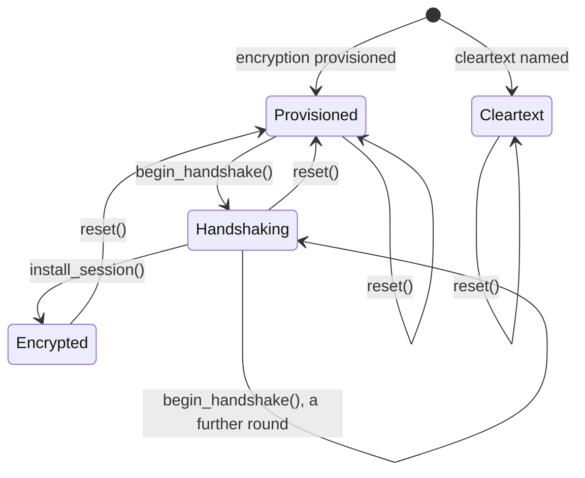
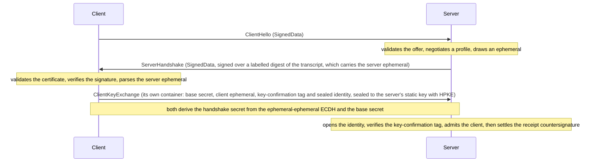
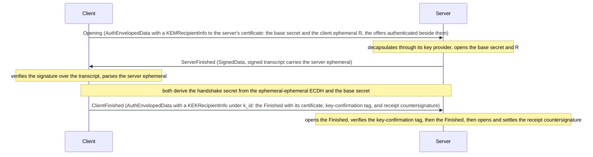
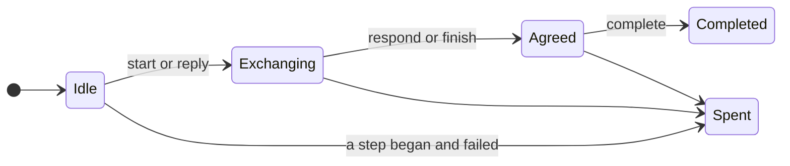
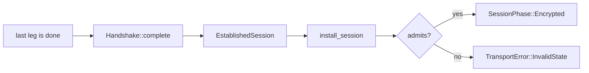
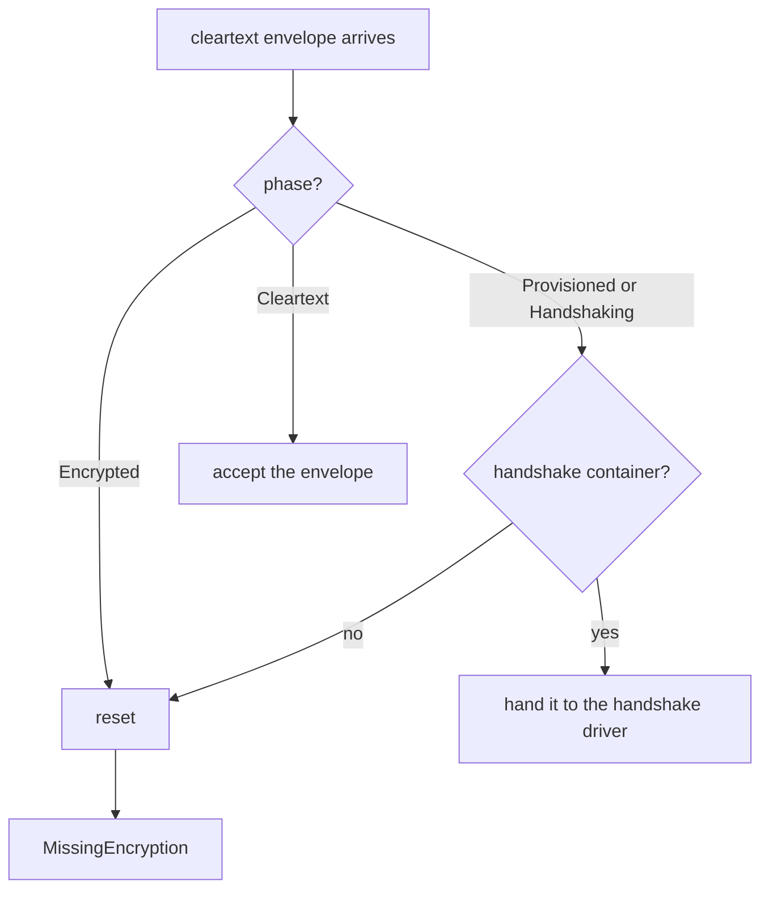

# The TightBeam Handshake

This document describes how a TightBeam session is established, which types carry that work, and which states the design refuses to represent. It covers the transport and handshake layers.

## Contents

- [Two protocols, one interface](#two-protocols-one-interface)
- [The session phase](#the-session-phase)
- [Message flow](#message-flow)
- [The orchestrator](#the-orchestrator)
- [Completion](#completion)
- [Peer authentication](#peer-authentication)
- [Key schedule](#key-schedule)
- [Transcript binding](#transcript-binding)
- [Signatures](#signatures)
- [Failure and the circuit breaker](#failure-and-the-circuit-breaker)

## Two protocols, one interface

TightBeam ships two handshake backends.

| Backend | Messages                                                                                                                     | The client's first message                                                                     |
| ------- | ---------------------------------------------------------------------------------------------------------------------------- | ---------------------------------------------------------------------------------------------- |
| HPKE    | Its own message types: the hello and the reply tunneled inside `SignedData`, the closing in a `ClientKeyExchange` of its own | `ClientHello`                                                                                  |
| CMS     | CMS containers, exchanged directly                                                                                           | The opening, an `AuthEnvelopedData` that seals the base secret to the server's certificate key |

In both, the session keys derive from an ephemeral-ephemeral ECDH and the base secret. See [Key schedule](#key-schedule).

Both backends meet the transport at one interface, so the driver moves a handshake message without knowing which protocol produced it. Each container travels as a `WireDer`, which keeps the decoded value together with the bytes it was encoded or received as. HPKE specifies no wire format (RFC 9180 § 10), so its closing travels in a container of its own that holds the HPKE message and the alert slot alone.

```rust
pub enum HandshakeMessage {
    /// Carries an HPKE `ClientHello` or `ServerHandshake`, or a CMS server
    /// Finished.
    SignedData(Box<WireDer<SignedData>>),
    /// Carries a CMS opening, or a CMS client Finished sealed under the
    /// identity key of the handshake secret (RFC 5083).
    AuthEnvelopedData(Box<WireDer<AuthEnvelopedData>>),
    /// Carries the closing of an HPKE handshake.
    ClientKeyExchange(Box<WireDer<ClientKeyExchange>>),
}
```

Each step accepts one container and refuses the others. A step asks for the one it expects, and any other fails the step with `HandshakeError::UnexpectedContainer`.

```rust
let opening = msg.auth_enveloped()?;   // refuses every other container
let finished = msg.signed()?;          // refuses every other container
let closing = msg.key_exchange()?;     // refuses every CMS container
```

On the transport, `TransportEnvelope` carries `SignedData` under context tag 3, `ClientKeyExchange` under 6, and `AuthEnvelopedData` under 7. Tags 2 and 5 are reserved and never reused, so an archived capture never decodes a stale meaning.

Because each protocol names its own container, the driver carries no per-protocol mapping. `ClientBuilder`, the connection pool and the `client!` macro all reach the same code.

## The session phase

A transport holds one `SessionState`, which pairs the endpoint's provisioning with one `SessionPhase`. The phase is the single record of where a session sits, and once encrypted it carries everything the handshake agreed.

```rust
pub enum SessionPhase {
    Cleartext,
    Provisioned,
    Handshaking { initiated_at: MonotonicInstant },
    Encrypted(Box<EstablishedSession>),
}
```

Carrying the session inside the phase means a half-installed session cannot be represented, and leaving the phase drops every term together.

The provisioning fixes where a session starts:

- An endpoint that holds encryption material starts in `Provisioned`.
- An endpoint that named cleartext starts in `Cleartext`.
- A reset always returns the session to that start.

A further handshake round keeps the `initiated_at` of the first round, so a slow peer cannot stretch the handshake deadline by one allowance per round.



`SessionPhase::admits` holds this table. `SessionState::apply` is the one writer of the phase, and it consults the table before it writes.

A move the table does not name leaves the session where it was. `begin_handshake` and `install_session` then return `false`, so an out-of-order install fails with `TransportError::InvalidState`.

| Attempted move             | Result  | Reason                                     |
| -------------------------- | ------- | ------------------------------------------ |
| `Cleartext -> Handshaking` | Refused | A cleartext endpoint holds no key material |
| `Cleartext -> Encrypted`   | Refused | No handshake ran                           |
| `Encrypted -> Handshaking` | Refused | A live session's keys would be dropped     |
| `Encrypted -> Encrypted`   | Refused | Keys would be replaced silently            |
| `Provisioned -> Encrypted` | Refused | The handshake never started                |

## Message flow

HPKE exchanges three messages. The last one seals the base secret to the server's certificate.



The client certificate and its possession signature travel inside the payload, sealed a second time under a key of the handshake secret. See [Client identity](#client-identity).

CMS exchanges three messages as well, but the client leads with the opening because the base secret travels sealed to the server's certificate key.



The client Finished embeds the certificate and signs under its key, so the whole Finished travels sealed under a key of the handshake secret. See [Client identity](#client-identity).

In both protocols the server reads the client's last message in one step, in this order:

1. It opens the closing. HPKE opens the payload with the static key, derives the handshake secret, and opens the identity under it. CMS opens the sealed Finished under the handshake secret it derived at the reply.
2. It compares the client ephemerals with the key of the offered certificate.
3. It verifies the [key-confirmation tag](#key-confirmation).
4. It admits the client: the validity period, the validators, and then the proof of possession.
5. It settles the receipt countersignature.

- The certificate checks and the proof run after the tag, so a client that derived another secret reaches no validator.
- A budget-bearing session activates only after the countersignature verifies.
- A refused settlement takes the handshake secret with it, so a replay of that message has nothing to complete with.

Both protocols negotiate the security profile through one policy, `ProfilePolicy`:

- The server chooses from its configured profiles. The list is a `SupportedProfiles`, which refuses an empty list with `NoSupportedProfiles` when it is built, so a server always has a profile to choose.
- The client admits the server's selection. It refuses a reply that selects nothing with `InvalidProfileSelection`.

## The orchestrator

One type, `Handshake<R, F, P>`, runs both roles over both protocols.

| Parameter | Values                | What it fixes                                                     |
| --------- | --------------------- | ----------------------------------------------------------------- |
| `R`       | `Client`, `Server`    | The step order and every negotiation and admission decision       |
| `F`       | `Hpke`, `Cms`         | The messages of the protocol and the checks those messages define |
| `P`       | A `HandshakeProvider` | The algorithms                                                    |

Each role runs three steps.

| Role   | Steps, in order                | Legs                                                     |
| ------ | ------------------------------ | -------------------------------------------------------- |
| Client | `start`, `respond`, `complete` | Sends the opening, reads the reply and sends the closing |
| Server | `reply`, `finish`, `complete`  | Reads the opening and sends the reply, reads the closing |

```rust
let mut client = Handshake::client(client_config);
let mut server = Handshake::server(server_config);

let opening = client.start()?;
let reply = server.reply(opening).await?;
let closing = client.respond(reply).await?;
server.finish(closing).await?;
```

The type of each configuration requires what its role cannot run without.

| Configuration           | What its type requires                                                                             |
| ----------------------- | -------------------------------------------------------------------------------------------------- |
| `ClientConfig<Hpke, P>` | A validator for the certificate the server names (`LearnedTrust`)                                  |
| `ClientConfig<Cms, P>`  | The provisioned server identity beside its trust store (`ProvisionedTrust`), and a client identity |
| `ServerConfig<F, P>`    | A `SigningIdentity`, and a profile list that is never empty (`SupportedProfiles`)                  |

### Phases

Both roles run one machine, read through `HandshakePhase`.



- A step outside its phase returns `HandshakeError::InvalidState` and leaves the phase unchanged.
- A step that began and failed leaves the handshake `Spent`. Every secret the phase held drops with that step, and no later step runs.
- `Completed` and `Spent` are terminal. A client driver drops its handshake when it returns. A server transport takes its handshake out of its slot to complete it, and a spent one drops with the transport.

A phase holds the facts its steps established, so a fact exists only after its step ran.

| Phase        | Client holds                                                          | Server holds                                                                    |
| ------------ | --------------------------------------------------------------------- | ------------------------------------------------------------------------------- |
| `Exchanging` | The sent opening, and the secrets that await the agreement            | The negotiated terms, the secrets that await the closing, and an issued receipt |
| `Agreed`     | The terms, the handshake secret, the receipt, and the admitted server | The terms, the handshake secret, the receipt, and the admitted client           |

## Completion

A completed handshake hands over everything it agreed in one value. Completion moves the terms out of the handshake and moves its phase to `Completed`. The terms are therefore read once, and a second completion fails with `HandshakeError::InvalidState`.

```rust
pub struct EstablishedSession {
    keys: SessionKeys,
    mux: Option<MuxSettings>,
    receipt: Option<Arc<StoredReceipt>>,
    peer: Option<Arc<Certificate>>,
    epoch: Option<EpochMaterials>,
}
```

The fields are private, so outside the crate the session answers named questions instead: `keys()`, `mux()`, `receipt()` and `peer()`.

`Handshake::complete` is the one completion of both roles, and the protocol traits delegate to it. A driver and a test therefore read the session terms the same way.

```rust
// The one completion.
let session = client.complete()?;

// Through the trait, which consumes the boxed handshake.
let session = ClientHandshakeProtocol::complete(client).await?;
```

Installing that session is one phase write. The write bounds both session ciphers by the endpoint's encrypted-envelope ceiling, so every install keeps the per-key volume inside the AES-GCM bound.

```rust
pub fn install_session(&mut self, session: EstablishedSession, encrypted_envelope: usize) -> bool {
    let bounded = session.with_envelope_ceiling(encrypted_envelope);
    self.apply(SessionEvent::Install(Box::new(bounded))).is_some()
}
```

The certificate and the receipt travel as `Arc`, so completion copies neither.



## Peer authentication

An endpoint must establish something about its peer before it dials. Any one of these does:

- A trust store.
- A server certificate.
- A requirement for a client certificate.

A client identity does not count, because it proves who the client is and says nothing about the server. An endpoint that holds none of the three, and did not name cleartext, is refused before any frame is sent (CWE-295).

```rust
pub fn check_dial_permitted(&self) -> TransportResult<()> {
    if !self.is_provisioned() && !self.allow_cleartext {
        return Err(TransportError::PeerAuthenticationUnconfigured);
    }

    Ok(())
}
```

`DialableEncryption::new` runs this check, and every `SessionState` is built from a `DialableEncryption`. The builder, the connection pool, the colony dialers and the `client!` macro are therefore all covered by one check.

A frame is sent through one of two places, and each carries the decision already made:

| Writer            | What closes it                                                                                                                                                                      |
| ----------------- | ----------------------------------------------------------------------------------------------------------------------------------------------------------------------------------- |
| `apply_wire_mode` | Reads the phase. `Encrypted` sends under the session key, `Cleartext` sends in the clear, and a pending handshake fails with `EncryptorUnavailable`                                 |
| `TransportWriter` | Takes its mode from the phase at `into_split`. An encrypted half owns the send key, a cleartext half comes only from a `Cleartext` phase, and a pending handshake refuses the split |

Running without authenticating the peer stays available as a named choice.

```rust
let client = ClientBuilder::<TokioListener>::builder()
    .allow_cleartext()
    .build()
    .connect(addr)
    .await?;
```

| Configuration                          | Sends frames | Reason                                        |
| -------------------------------------- | ------------ | --------------------------------------------- |
| Trust store                            | Yes          | The peer is authenticated                     |
| Client validators                      | Yes          | A mutual-auth server authenticates its client |
| Server certificate                     | Yes          | A server presents its own identity            |
| Client identity alone                  | No           | Nothing establishes who the peer is           |
| Client identity plus `allow_cleartext` | Yes          | The risk is named                             |

### Admit a client

A server admits its client through one rule in both protocols, and `PeerAuthentication::admit` is its one home. It takes an `Offer`, which holds a certificate beside the proof that the client holds its key, or holds nothing:

- HPKE carries the proof as a signature over the domain `tb/handshake/client-auth/hpke/v1`, the transcript hash, the client ephemeral `R`, and the certificate DER. The certificate and the signature travel as one sealed `HpkeIdentity`.
- CMS carries it as the signature of the client Finished, which travels sealed with the certificate it embeds.

| Client offers             | Anonymous server                 | Mutual server                                                             |
| ------------------------- | -------------------------------- | ------------------------------------------------------------------------- |
| Nothing                   | Admitted, no peer recorded       | Refused, `MissingClientCertificate`                                       |
| A certificate and a proof | Proof verified, no peer recorded | Validity period read, every validator runs, proof verified, peer recorded |

A certificate without its proof, or a proof without its certificate, has no `Offer`, so it never reaches admission. A CMS Finished is itself a proof, so a CMS server refuses one that names no certificate with `MissingClientCertificate`, under either policy.

## Key schedule

Both backends and both roles derive every traffic key from one `HandshakeSecret`. `HandshakeSecret::hybrid` is its only constructor.

```text
hs      = HKDF(ee || base, salt = S, info = "tb/session/kdf/v1")
k_c2s   = HKDF(hs, S, "tb/session/kdf/c2s/v1")
k_s2c   = HKDF(hs, S, "tb/session/kdf/s2c/v1")
epoch_0 = HKDF(hs, S, "tb/session/kdf/epoch/v1")
k_ack   = HKDF(hs, S, "tb/session/kdf/ack/v1")
k_id    = HKDF(hs, S, "tb/session/kdf/identity/v1")
mac_key = HKDF-Expand-H(HKDF-Extract-H(S, hs), "tb/handshake/finished/v1", Hash.length)
confirm = HMAC-H(mac_key, transcript_hash)
```

| Input  | What it is                                                                                           |
| ------ | ---------------------------------------------------------------------------------------------------- |
| `ee`   | The ECDH output of the client's ephemeral and the server's ephemeral                                 |
| `base` | The 32-byte base secret the client seals to the server's static key                                  |
| `S`    | The salt: `client_random \|\| server_random` for HPKE, the transcript hash for CMS                   |
| `HKDF` | The KDF of the profile, extract then expand under its own hash: HKDF-SHA3-256 in the default profile |
| `H`    | The negotiated digest, SHA3-256 in the default profile. `Hash.length` is its output length           |

`ee || base` is the hybrid shared secret `Z′ = Z || T` of NIST SP 800-56C Rev. 2 § 2: the shared secret `Z` of the key-establishment scheme, followed by an auxiliary secret `T` whose content, format, and length both endpoints fix in advance. Each part is 32 bytes wide, so the plain concatenation is unambiguous.

### Ephemeral keys

The server draws a fresh ephemeral, `E`, for each handshake and carries it inside the transcript it signs. A client draws `R` for this agreement alone, because the key its seal encapsulates under serves that seal alone: RFC 9180 § 9.2.3 says so of HPKE, and RFC 9629 § 7 of a `KEMRecipientInfo`.

| Step                          | HPKE                                                                                         | CMS                                        |
| ----------------------------- | -------------------------------------------------------------------------------------------- | ------------------------------------------ |
| Client ephemeral              | `R`, a field of the sealed payload                                                           | `R`, a field of the sealed opening content |
| Client draws its private half | In `respond`, after the receipt is approved and countersigned, in a step that awaits nothing | In `start`, with the opening               |
| Client drops its private half | In `respond`, at the agreement                                                               | In `respond`, at the agreement             |
| Server drops its private half | In `finish`, which takes it on every outcome                                                 | In `reply`, where it is a local            |

Every received ephemeral is parsed before any scalar multiplication runs on it. `PeerPoint::parse` is the one parse of an ephemeral that the handshake secret agrees with, and `PeerEphemeral` runs it before its comparison. It refuses a malformed, off-curve, or identity point, and the agreement of the handshake secret takes no other point type.

An ephemeral with the x-coordinate of its sender's static key would collapse the agreement into the static one, so each side refuses it. The two sides learn that static key at different times, so the comparison has two homes:

| Comparison                                                                                                   | Home            | When                                                    |
| ------------------------------------------------------------------------------------------------------------ | --------------- | ------------------------------------------------------- |
| A client compares `E` with the server's static key                                                           | `PeerEphemeral` | At the reply, before the agreement                      |
| A server compares `R` and the encapsulated key (HPKE), or `R` (CMS), with the key of the offered certificate | `Offer::new`    | At the closing, once the identity opens, before the tag |
| A rekey server compares `Ce` with the client's static key                                                    | `PeerEphemeral` | At the request, where the client's key is already known |
| A rekey client compares `Se` with the server's static key                                                    | `PeerEphemeral` | At the response                                         |

Three facts fix what a server compares:

- The comparison is on the x-coordinate. ECDH keeps that coordinate alone, so a key and its negation agree to one secret.
- The client's static key is the key of the certificate it offers, which a server reads only once the identity opens. An anonymous client holds none.
- An HPKE client sends two ephemerals, `R` and the encapsulated key of the seal, and the server checks both.
- A CMS opening carries the KEM's ephemeral as `kemct`. Its shared secret derives the key-encryption key alone and never feeds the handshake secret, so the server compares `R` alone.

### Forward secrecy

An observer who records a session and later obtains the server's static key recovers the base secret and nothing below it.

| Value                       | Observer with the static key | Reason                                                   |
| --------------------------- | ---------------------------- | -------------------------------------------------------- |
| `base`                      | Recovers                     | The static key opens the HPKE payload or the CMS opening |
| `S`                         | Recovers                     | Public in the handshake messages                         |
| `ee`                        | Does not recover             | Needs `r` or `e`, and neither side kept its own          |
| `hs` and every key below it | Does not recover             | One input unknown                                        |
| Client identity             | Does not recover             | Sealed under `k_id`, below `hs`                          |

The traffic keys, the sealed receipt acknowledgement, the sealed client identity, and every rekey epoch sit below `hs`, so the rekey chain inherits the property.

### Rekey

Each renewal runs a fresh agreement. The client sends an ephemeral `Ce` on the request, and the server an ephemeral `Se` on the response.

```text
epoch_next = HKDF(u32be(32) || epoch || u32be(32) || ee, salt = client_random || server_random, info = "tb/session/kdf/epoch/v1")
```

`ee` is the ECDH output of the two rekey ephemerals, and `u32be(n)` is the 4-byte big-endian length of the input that follows it. A holder of one epoch secret who records the renewal lacks `ee`, so the holder derives nothing of the next epoch.

| Rule                                                                      | Where it is enforced                                                                                                                                  |
| ------------------------------------------------------------------------- | ----------------------------------------------------------------------------------------------------------------------------------------------------- |
| The next epoch needs a rekey scalar                                       | `EpochSecret::next` runs the agreement itself                                                                                                         |
| Both ephemerals are authenticated                                         | The server signs a receipt over `H(hash \|\| request \|\| server_random \|\| Se)`, the request carries `Ce`, and the client countersigns that receipt |
| A peer ephemeral is a point on the curve, and never the peer's static key | `PeerEphemeral` yields a `PeerPoint`, the one point type `EpochSecret::next` takes                                                                    |
| The server holds no rekey scalar across an await or between legs          | It agrees and drops its scalar before it awaits its authorizer, and it holds the derived secret until the acknowledgement                             |
| The client holds its rekey scalar across no await of a step               | The scalar waits boxed between the request and the response. `EpochSecret::next` takes it by value before the client awaits its approver              |

### Traffic secrets

The directional derivation accepts only a `TrafficSecret`, a sealed trait with two implementors. Every traffic key therefore traces back to a handshake secret.

| Secret            | Constructors                                                                                                      |
| ----------------- | ----------------------------------------------------------------------------------------------------------------- |
| `HandshakeSecret` | `HandshakeSecret::hybrid`                                                                                         |
| `EpochSecret`     | `EpochMaterials::derive`, from a handshake secret. `EpochSecret::next`, from the last epoch and a fresh agreement |

### Seals

Every seal of the handshake but one is an `AuthEnvelopedData` (RFC 5083) under the provider's AEAD, AES-256-GCM for the house provider. The exception is the HPKE flow's session payload, which HPKE (RFC 9180) seals to the server's static key until the HPKE containers move to CMS, and that payload carries the envelopes of the identity and the acknowledgement. Each envelope holds to these rules:

- Each seal draws a random content key of the key size of the provider's AEAD, 32 octets for the house provider, and a random 12-octet nonce.
- `GCMParameters` (RFC 5084 § 3.2) names the nonce and a 16-octet tag, and the tag travels in `mac`.
- `AuthEnvelopedData::open` takes the envelope by value and decrypts the ciphertext in the buffer it arrived in, so the content is never copied.
- The authenticated attributes carry the content type. Their DER under the universal `SET OF` tag is the associated data (RFC 5083 § 2.2), so an opener refuses authenticated attributes that did not arrive in DER.
- One `RecipientInfo` wraps the content key with the provider's key wrap: AES-256 key wrap, `id-aes256-wrap` (RFC 3565, RFC 3394), for the house provider. The cipher, the KDF, the wrap, and the KEM are each the provider's, and an opener refuses an envelope that names another.

| Seal                        | Recipient                                                     | Key-encryption key                                                                                                                                                                             |
| --------------------------- | ------------------------------------------------------------- | ---------------------------------------------------------------------------------------------------------------------------------------------------------------------------------------------- |
| The CMS opening             | `KEMRecipientInfo` (RFC 9629) to the server's certificate key | The provider's KDF of the DHKEM shared secret, empty salt, `DER(CMSORIforKEMOtherInfo)` as `info`, for the key size of the provider's wrap: HKDF-SHA3-256 and 32 octets for the house provider |
| The receipt acknowledgement | `KEKRecipientInfo` (RFC 5652 § 6.2.3)                         | `k_ack`                                                                                                                                                                                        |
| The client identity         | `KEKRecipientInfo`                                            | `k_id`                                                                                                                                                                                         |

`Opener::unwrap` is the one decision on the kind of a `RecipientInfo`. Before any key runs, it refuses another recipient kind, a `ukm` of another purpose, a `kekid` of another key, an algorithm outside the profile, and a `kekLength` other than the key size of the provider's wrap, 32 for the house provider. `AuthEnvelopedData::open` refuses authenticated attributes that did not arrive in DER, a version other than 0, a cipher other than the provider's AEAD with `GCMParameters`, AES-256-GCM for the house provider, a tag length other than 16, a missing content-type attribute, and another content type.

#### The opening

The opening's `KEMRecipientInfo` holds these fields.

| Field       | Value                                                                                                                                                  |
| ----------- | ------------------------------------------------------------------------------------------------------------------------------------------------------ |
| `version`   | 0                                                                                                                                                      |
| `rid`       | The server certificate's `subjectKeyIdentifier`, else its issuer and serial number                                                                     |
| `kem`       | `1.3.6.1.4.1.64586.2.3`, parameters absent: DHKEM(secp256k1, HKDF-SHA256), HPKE KEM `0x0016`, which [dhkem-secp256k1.md](dhkem-secp256k1.md) specifies |
| `kemct`     | DHKEM's `enc`, the 65-octet uncompressed point of an ephemeral drawn for this seal                                                                     |
| `kdf`       | `id-alg-hkdf-with-sha3-256` (RFC 9688 § 5.1), parameters absent, so the salt is empty                                                                  |
| `kekLength` | 32                                                                                                                                                     |
| `ukm`       | `tb/handshake/opening/ukm/v1` followed by 32 random octets that the seal draws for itself                                                              |
| `wrap`      | `id-aes256-wrap`                                                                                                                                       |

- The content, of type `1.3.6.1.4.1.64586.1.25`, is `SEQUENCE { baseSecret OCTET STRING, agreementKey OriginatorPublicKey }`: the base secret and `R`.
- The authenticated attributes carry the security and transport offers beside the content type. The unauthenticated attributes carry the abort alert alone.
- The server opens the opening, and so checks its tag, before it chooses a profile or asks its transport authorizer, so neither reads an offer the tag has not covered.
- The server's key provider runs `DH(skS, enc)`, so the static key can stay behind an external boundary. The DHKEM shared secret derives the key-encryption key alone (RFC 9629 § 7).
- Until the server holds a key-agreement certificate apart from its signing certificate, its one certificate both signs the Finished and receives the opening.

#### Seals under the handshake secret

The acknowledgement and the identity each seal under a key of the handshake secret, through a `KEKRecipientInfo` of version 4:

- The key-encryption key is `k_ack` or `k_id`, of the key size of the provider's wrap, 32 octets for the house provider.
- `kekid.keyIdentifier` is the purpose's label followed by the transcript hash: `tb/handshake/ack/kekid/v1` for the acknowledgement, `tb/handshake/identity/kekid/v1` for the identity.
- The transcript hash is also an authenticated attribute (`1.3.6.1.4.1.64586.1.8`), which the opener checks before the content decrypts, so a seal moved to another session fails to open, even under the right key.
- The content type is `id-data`, because the framed and padded plaintext is opaque octets.

### Receipt acknowledgement

The acknowledgement is the client's receipt `SignerInfo`, sealed under `k_ack` as [Seals](#seals) states. The DER of its envelope travels in the `RECEIPT_ACK` attribute of the CMS Finished, or in the `receipt_ack` field of the HPKE payload.

- A sealed answer moved to another session fails to open, even under the right key.
- The label names the acknowledgement's key in the `kekid`, so an opener of another purpose refuses the seal by its key identifier.

### Client identity

A client seals its certificate and its proof of possession under `k_id`, as [Seals](#seals) states.

| Protocol | What is sealed                                                                       | Where it travels                                                                   |
| -------- | ------------------------------------------------------------------------------------ | ---------------------------------------------------------------------------------- |
| HPKE     | One `HpkeIdentity`: the certificate and the possession signature                     | `sealed_identity`, a field of the HPKE payload, as the DER of its envelope         |
| CMS      | The client Finished, which embeds the certificate, the tag, and the countersignature | The whole closing: an `AuthEnvelopedData` with one `KEKRecipientInfo` under `k_id` |

- The sealed plaintext is a big-endian `u16` length, the sealed DER, and zero bytes up to the next multiple of 512 bytes, at least 1024. Certificates whose lengths differ within one block give closings of one length. A CMS Finished adds about 280 bytes to its certificate, and about 590 when it carries a receipt countersignature, so a CMS fleet reaches the first block boundary at certificates of about 740 bytes, or about 430 on a budget-bearing session.
- Two length signals remain by decision. A fleet whose identities straddle a block boundary splits into two lengths. Under an anonymous HPKE server, a closing that offers an identity is longer than one that offers none, as a TLS 1.3 client certificate shows its presence too.
- A passive observer reads no byte of the certificate, its key identifier, its issuer and serial number, its key, or the signature.
- An observer that later obtains the server's static key opens the HPKE payload or the CMS opening, but lacks `ee` and therefore `k_id`.
- `k_ack` and `k_id` derive under two labels from one `hs`, and each wraps the random content key of one seal.

### Key confirmation

The client proves on the closing that it derived `hs`. It sends `confirm`, and the server derives the same tag and compares the two in constant time before it settles.

The tag follows the Finished construction of TLS 1.3 (RFC 9846 § 4.5.3) under the negotiated digest `H`, with the crate's label as the HKDF-Expand info in place of `HkdfLabel`:

1. `hs` is the 32-byte output of the profile's KDF. RFC 5869 § 2.3 asks for a PRK of at least `Hash.length` octets, so `hs` is too short a PRK for a 64-byte digest. `HKDF-Extract-H(S, hs)` therefore makes a PRK first, under every digest.
2. `mac_key` expands from that PRK under the label `tb/handshake/finished/v1` to `Hash.length` bytes. It keys this one tag.
3. `confirm = HMAC-H(mac_key, transcript_hash)`, as wide as the output of `H`: 32 bytes under SHA3-256, 64 under SHA3-512.

NIST SP 800-56A Rev. 3 § 5.9 is not claimed. Its confirming party owns a static key-establishment key, and the client owns none.

| Protocol | Where the tag travels                                                             | A closing with no tag fails with                     |
| -------- | --------------------------------------------------------------------------------- | ---------------------------------------------------- |
| HPKE     | A field of the sealed payload                                                     | `InvalidDecryptedPayloadSize`, at the payload decode |
| CMS      | An unsigned attribute of the sealed client Finished, OID `1.3.6.1.4.1.64586.1.24` | `MissingAttribute`, where the Finished opens         |

- A tag that differs is refused with `KeyConfirmationFailed`. The refusal runs ahead of settlement, so the authorizer's settlement and the session observer hear nothing of a client that holds another secret.
- A tag of another digest's width differs, so it is refused the same way. A tag narrower than 32 bytes or wider than 64 fails to decode.
- The tag derives from `hs` and the transcript hash, so it reveals neither and confirms no other handshake. The CMS attribute therefore needs no signature over it.
- The confirmation is one-way. The server learns at the closing that the secrets match, and the client learns at its first record.

## Transcript binding

The transcript hash is the whole output of the negotiated digest: 32 bytes under SHA3-256, 64 under SHA3-512. A digest whose output is narrower than 32 bytes or wider than 64 fails the seal with `TranscriptDigestLength`. Every value that carries the hash takes that width:

- the CMS salt and the content each CMS Finished signs,
- the bytes each HPKE signature covers,
- the `kekid` and the authenticated attributes of each seal under the handshake secret,
- the `DigestInfo` of the session receipt, and
- the root of the rekey chain, and each link after it.

The CMS transcript hashes the container DER on both sides. The sender hashes the bytes it encoded, and the receiver hashes the bytes it received, so the binding is byte-level.

The receiver hashes the bytes that arrived, and not a re-encoding of what it decoded. The pinned `der` decoder is the reason:

1. The decoder sorts a `SET OF` before it validates it, so a mis-ordered set decodes to the same value as the well-ordered one.
2. A re-encoding of that value is the well-ordered bytes, whatever arrived.
3. Hashing the bytes that arrived makes a reordered set diverge the two transcript hashes, and signature verification fails (CWE-345).

| What the transcript binds        | Read through                         |
| -------------------------------- | ------------------------------------ |
| A container                      | `WireDer::der`                       |
| An accept or ephemeral attribute | `HandshakeAttribute::received_bytes` |

The HPKE transcript binds the `ClientHello` DER and the accept encodings the same way. It also binds the server's certificate demand as one byte between the two accepts, so a flipped `client_cert_required` fails the server signature.

Each handshake signature covers a label of its own ahead of the bytes it binds, and no label is a prefix of another, so a signature made for one purpose verifies as no other.

| Signature              | What it signs                                                                                                             |
| ---------------------- | ------------------------------------------------------------------------------------------------------------------------- |
| HPKE server reply      | The provider digest of `tb/handshake/server-auth/hpke/v1` and the transcript hash                                         |
| HPKE client possession | The provider digest of `tb/handshake/client-auth/hpke/v1`, the transcript hash, `R`, and the certificate DER              |
| CMS server Finished    | Its signed attributes, whose message digest covers its content: `tb/handshake/finished/server/v1` and the transcript hash |
| CMS client Finished    | Its signed attributes, whose message digest covers its content: `tb/handshake/finished/client/v1` and the transcript hash |

Both transcripts bind both ephemerals.

| Ephemeral        | Bound by                                                                                                                      | Tampering fails at                                                                                                  |
| ---------------- | ----------------------------------------------------------------------------------------------------------------------------- | ------------------------------------------------------------------------------------------------------------------- |
| Server `E`, HPKE | A fixed-width leg of the signed transcript                                                                                    | The server signature. One of another width fails `OctetStringLengthError` before it                                 |
| Server `E`, CMS  | The last `ServerFinishedLegs` entry before the transcript seals                                                               | The server signature. A removed one fails `MissingAttribute` before the seal                                        |
| Client `R`, HPKE | The sealed payload carries `R`, so the AEAD authenticates it, and the possession signature of an identified client covers `R` | The payload open (`HpkeError`). A point off the curve fails `InvalidPublicKey` at the payload parse                 |
| Client `R`, CMS  | The opening content carries `R` under the tag, and the opening DER is the first transcript leg                                | The opening's tag (`HandshakeError::Envelope`). A point off the curve fails `InvalidPublicKey` at the content parse |

A swapped server ephemeral fails the server signature before any key agreement runs.

## Signatures

Every handshake signature is made under a `SigningIdentity`: a certificate and the `SigningKeyProvider` that holds its private key. Its constructor refuses a key whose public half differs from the certificate's SubjectPublicKeyInfo, so a signature verifies under the certificate it names.

| Endpoint        | Where the identity is held                                                              |
| --------------- | --------------------------------------------------------------------------------------- |
| Server          | `ServerConfig.identity`, which `TransportEncryptionConfig::new` fills                   |
| CMS client      | `CmsClientSettings.identity`                                                            |
| HPKE client     | `HpkeClientSettings.identity`, absent for an anonymous client                           |
| Transport build | `with_client_identity` on `ClientBuilder` and `ConnectionPool`, and the `client!` macro |

Each signature value is the DER `ECDSA-Sig-Value` (RFC 3279 § 2.2.3). The HPKE server reply and the HPKE possession proof carry it bare. The CMS Finished and the session receipt carry it in a `SignerInfo`.

- A signer emits `s` in the low half of the curve order. The identity brings every value its provider returns to that form, and refuses a value that is not DER.
- A verifier parses DER alone, so a raw `r‖s` signature fails. It normalizes `s` to the low half and then verifies, because ECDSA verifies both values (SEC 1 v2.0 § 4.1.4).
- The verified signature in that low-`s` form is the replay key, so a capture with `s` flipped finds the slot its original spent.

One signer of `crypto::sign`, `CmsSigner`, builds every `SignerInfo` the handshake emits, and every `SignedData` that carries one, and verifies every one it reads (RFC 5652 § 5.4). The signerless HPKE tunnels are the one other `SignedData` the handshake emits.

| Field                         | Rule                                                                                                                        |
| ----------------------------- | --------------------------------------------------------------------------------------------------------------------------- |
| `SignerInfo.sid`              | The subjectKeyIdentifier extension of the certificate, or its issuer and serial number when it carries none                 |
| `SignerInfo.version`          | 3 under a subjectKeyIdentifier, 1 under an issuer and serial number (RFC 5652 § 5.3)                                        |
| `SignerInfo.digestAlgorithm`  | The digest the signature algorithm names (RFC 5753 § 2.1.1), fixed by the signature type                                    |
| `SignerInfo.signedAttrs`      | Content type, message digest, and `CMSAlgorithmProtection` (RFC 6211), beside the attributes of the profile. Always present |
| `SignedData.version`          | The rule of RFC 5652 § 5.1, which a reader checks before it reads the content                                               |
| `SignedData.digestAlgorithms` | Every digest algorithm a signer names                                                                                       |

- A reader refuses a digest the signature algorithm does not name, a missing or extra signed attribute, an algorithm protection that names other algorithms, and a version that breaks its rule.
- The signer returns a `SignedData` as `Signed<SignedData>`, the form a session receipt keeps, and a `SignerInfo` as `Signed<SignerInfo>`, the form a frame keeps. The signer builds each value the crate emits, and the DER decoder yields each one it reads.
- The HPKE hello and reply travel in a `SignedData` that holds no signer, so the transport reaches them through the one container type.

## Failure and the circuit breaker

`SessionState::reset` returns a session to its start. Because the phase carries the session, the reset drops the keys, the receipt, the peer certificate, the mux terms and the epoch materials together.



The colony gates and the cluster export rules authorize a request by the peer certificate, so a session that was torn down must not leave the previous peer's identity readable.

An end of stream is named by the phase it interrupted.

| The peer disconnects while | Error                                                                |
| -------------------------- | -------------------------------------------------------------------- |
| A handshake is pending     | `PeerClosedBeforeHandshake`                                          |
| A session is agreed        | `ConnectionClosed`, which a pool acts on when it evicts a connection |

## Sources

- RFC 5652, Cryptographic Message Syntax: <https://datatracker.ietf.org/doc/html/rfc5652>
- RFC 5083, CMS Authenticated-Enveloped-Data Content Type: <https://datatracker.ietf.org/doc/html/rfc5083>
- RFC 5084, AES-CCM and AES-GCM in CMS, § 3.2 on `GCMParameters`: <https://datatracker.ietf.org/doc/html/rfc5084#section-3.2>
- RFC 9629, Using Key Encapsulation Mechanism (KEM) Algorithms in CMS: <https://datatracker.ietf.org/doc/html/rfc9629>
- RFC 9688, Use of the SHA3 One-Way Hash Functions in CMS, § 5.1 on HKDF with SHA3-256: <https://datatracker.ietf.org/doc/html/rfc9688#section-5.1>
- RFC 3394, AES Key Wrap Algorithm, and RFC 3565, AES in CMS: <https://datatracker.ietf.org/doc/html/rfc3394>, <https://datatracker.ietf.org/doc/html/rfc3565>
- RFC 5280, Internet X.509 Public Key Infrastructure Certificate and CRL Profile: <https://datatracker.ietf.org/doc/html/rfc5280>
- RFC 5869, HMAC-based Extract-and-Expand Key Derivation Function (HKDF): <https://datatracker.ietf.org/doc/html/rfc5869>
- RFC 9180, Hybrid Public Key Encryption, § 9.2.3 on reuse of the KEM randomness: <https://datatracker.ietf.org/doc/html/rfc9180#section-9.2.3>
- RFC 9180, Hybrid Public Key Encryption, § 10 on the message encoding an application defines: <https://datatracker.ietf.org/doc/html/rfc9180#section-10>
- RFC 5116, An Interface and Algorithms for Authenticated Encryption, § 3.1 on nonce generation: <https://datatracker.ietf.org/doc/html/rfc5116#section-3.1>
- RFC 9846, The Transport Layer Security (TLS) Protocol Version 1.3, § 4.5.3 on the Finished construction: <https://datatracker.ietf.org/doc/html/rfc9846#section-4.5.3>
- NIST SP 800-56C Rev. 2, Recommendation for Key-Derivation Methods in Key-Establishment Schemes, § 2 on the hybrid shared secret: <https://doi.org/10.6028/NIST.SP.800-56Cr2>
- NIST SP 800-56A Rev. 3, Pair-Wise Key-Establishment Schemes Using Discrete Logarithm Cryptography, § 5.9 on key confirmation, which the tag does not claim: <https://doi.org/10.6028/NIST.SP.800-56Ar3>
- CWE-295, Improper Certificate Validation: <https://cwe.mitre.org/data/definitions/295.html>
- CWE-311, Missing Encryption of Sensitive Data: <https://cwe.mitre.org/data/definitions/311.html>
- CWE-345, Insufficient Verification of Data Authenticity: <https://cwe.mitre.org/data/definitions/345.html>
