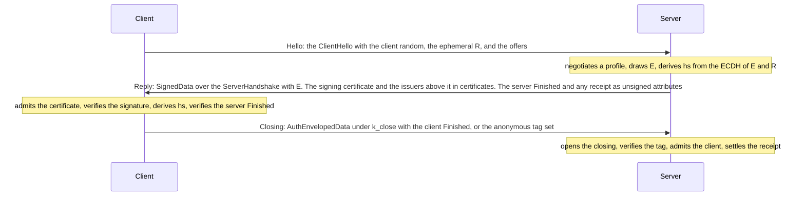
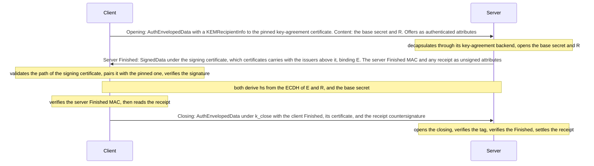
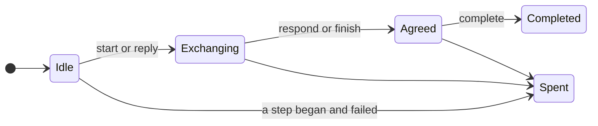
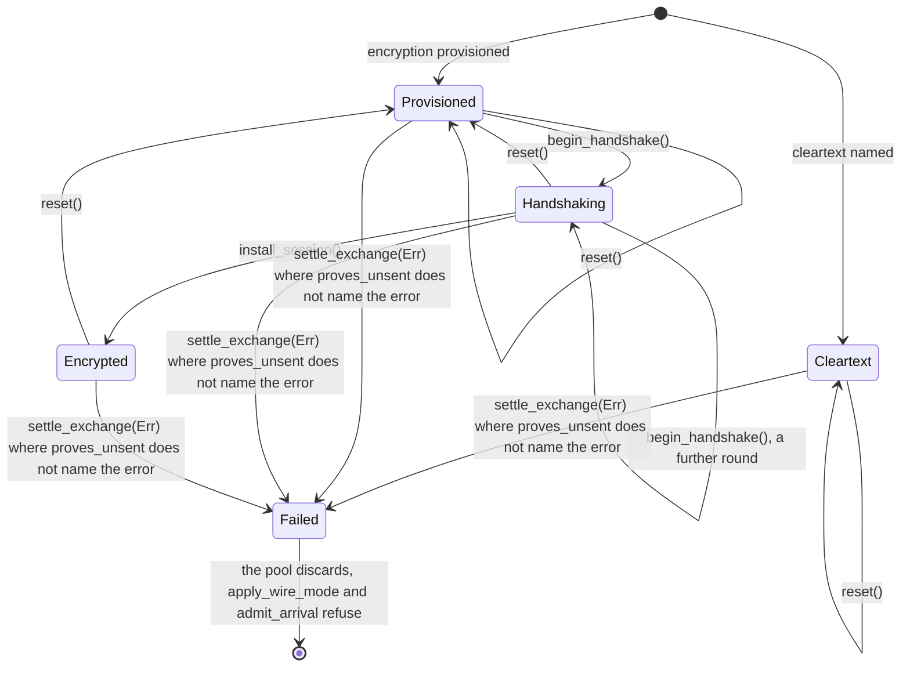
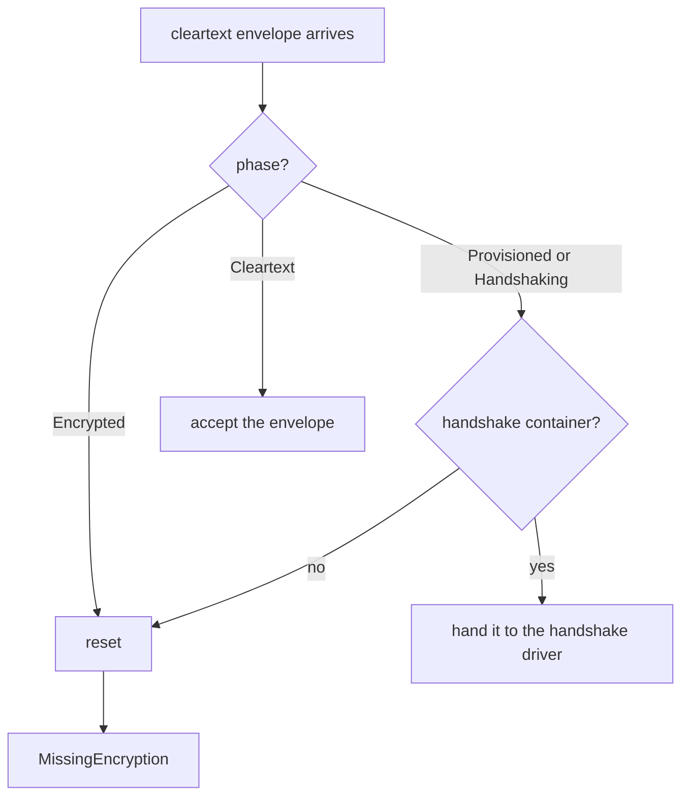

# The TightBeam Handshake

This page specifies how two TightBeam endpoints establish a session: the messages of each flow, the keys they derive, the certificates they admit, and the types that enforce each rule. It is a reference for engineers who build on the handshake or review it.

## Contents

- [The two flows](#the-two-flows)
- [Message flow](#message-flow)
- [Wire containers](#wire-containers)
- [Certificates and trust](#certificates-and-trust)
- [Key schedule](#key-schedule)
- [Envelopes](#envelopes)
- [Transcript binding](#transcript-binding)
- [Signatures](#signatures)
- [Implementation](#implementation)
- [Sources](#sources)

## The two flows

TightBeam has two handshake flows. Both send three messages, encode every message as a CMS type (RFC 5652), and close the same way.

|                     | HPKE flow                                                            | CMS flow                                                                                                                      |
| ------------------- | -------------------------------------------------------------------- | ----------------------------------------------------------------------------------------------------------------------------- |
| Shape               | The TLS 1.3 handshake (RFC 9846) in CMS containers                   | The client seals its first message to the server's key-agreement certificate                                                  |
| First message       | The hello: a `ContentInfo` of type `id-data` with the `ClientHello`  | The opening: an `AuthEnvelopedData` with the base secret and the client ephemeral                                             |
| Server certificates | One signing certificate, sent in the reply with the issuers above it | A signing certificate, sent in the server Finished with the issuers above it, and a key-agreement certificate the client pins |
| Handshake secret    | `ee`, the ECDH output of the two ephemerals                          | `ee \|\| base`, which adds the base secret of the opening                                                                     |

## Message flow

### HPKE flow



The HPKE flow claims these properties of RFC 9846 Appendix F.1:

| Property                                                    | Claimed | Why                                                                               |
| ----------------------------------------------------------- | ------- | --------------------------------------------------------------------------------- |
| Server authentication before the client sends its identity  | Yes     | The client verifies the reply's signature over the transcript first               |
| Client identity protected from passive and active attackers | Yes     | It travels only under a key of this handshake's ephemeral agreement               |
| Forward secrecy                                             | Yes     | The secret comes from two ephemerals alone                                        |
| Server identity protected from a passive attacker           | No      | The signing certificate and its issuers travel in clear in `certificates`         |
| Explicit server key confirmation                            | Yes     | The reply carries the server Finished, which the client verifies before it closes |

### CMS flow



The CMS flow differs from the HPKE flow in three ways:

- The client pins the server's key-agreement certificate alone. The server Finished carries the signing certificate and the issuers above it (RFC 5652 § 5.1), and the client admits it at each reply. See [The CMS server's two certificates](#the-cms-servers-two-certificates).
- The secret is hybrid, so an observer needs both the ephemeral agreement and the key-agreement key. See [Forward secrecy](#forward-secrecy).
- A CMS client always presents its identity, so it always sends a client Finished.

As in the HPKE flow, a passive observer reads the signing certificate. The opening's `rid` also names the key-agreement certificate in clear (RFC 9629 § 3).

### Rules of both flows

1. The client confirms the server Finished before it verifies the session receipt or runs the receipt approver. `PendingReceipt::verify` takes the `ServerConfirmed` that the confirmation yields. Only a holder of the handshake secret computes the MAC, so a certificate the store admits for the server's name, which this server never sent, reaches neither step (RFC 9846 § 4.5.3).
2. The client builds its closing only from that `ServerConfirmed`, and `ServerConfirmed::confirm` takes the `ReplyVerified` that only `ClientLegs::verify_reply` yields. No closing exists before both checks.
3. The server reads the closing in one step, in this order:
   1. It opens the closing under `k_close`, in the form its content type names.
   2. It compares the client ephemeral `R` with the key of the offered certificate.
   3. It verifies the [key-confirmation tag](#key-confirmation).
   4. It admits the client: the validity period, the validators, and then the client Finished.
   5. It settles the receipt countersignature.

   The order has these results:

   - A client that derived another secret reaches no validator.
   - A budget-bearing session activates only after the countersignature verifies.
   - A refused settlement drops the handshake secret, so a replay of that message has nothing to complete.

4. One `ProfilePolicy` negotiates the security profile. The server chooses from a `SupportedProfiles`, which cannot be empty (`NoSupportedProfiles`). The client refuses a reply that selects nothing (`InvalidProfileSelection`). Each side holds the profile to the strength floor its provider names, `CryptoProvider::strength_floor`, and refuses a profile below it (`BelowStrengthFloor`).

## Wire containers

Every handshake message is one `HandshakeMessage`. Each variant holds a `WireDer`, the decoded value beside the bytes it was encoded or received as.

| Variant             | Carries                                        | `TransportEnvelope` tag |
| ------------------- | ---------------------------------------------- | ----------------------- |
| `Data`              | The HPKE hello                                 | 8                       |
| `SignedData`        | The HPKE reply, or the CMS server Finished     | 3                       |
| `AuthEnvelopedData` | The CMS opening, or the closing of either flow | 7                       |

- Tags 2, 5, and 6 are reserved and never reused, so an archived capture never decodes to a stale meaning.
- A step asks for the one container it expects (`data()`, `signed()`, or `auth_enveloped()`), and any other fails with `HandshakeError::UnexpectedContainer`.

## Certificates and trust

### Certificate use

Every certificate is admitted for one use and one role before its key is read. `PeerCertificate<U>` is that admission, and `PeerCertificate::parse` is its one constructor for a peer's certificate.

| Use               | Its readers                                                                                    | `keyUsage` bit                                                   |
| ----------------- | ---------------------------------------------------------------------------------------------- | ---------------------------------------------------------------- |
| `Signing<P>`      | The verifiers of the HPKE reply, the CMS server Finished, the client Finished, and the receipt | `digitalSignature`                                               |
| `KeyAgreement<K>` | The CMS client that seals the opening, and `KeyAgreementIdentity::new`                         | `RecipientKem::USAGE` of `K`: `keyAgreement` for the house DHKEM |
| `ErasedSigning`   | The trust store, and `SigningIdentity::with_provider`                                          | `digitalSignature`                                               |

The role is an `extendedKeyUsage` purpose (RFC 5280 § 4.2.1.12). `KeyPurposes` maps each role to one purpose, and `KeyPurposes::HOUSE` holds the defaults:

| Role   | Its certificates                                    | House purpose                                 | Checked by                                                                     |
| ------ | --------------------------------------------------- | --------------------------------------------- | ------------------------------------------------------------------------------ |
| Server | The server's signing and key-agreement certificates | `id-kp-serverAuth`                            | The client's `ServerTrust`, and the server's own configuration, once           |
| Client | The certificate of the client identity              | `id-kp-clientAuth`                            | The server when it opens the closing, and the client's own configuration, once |
| Signer | The certificate of a frame or colony signer         | `KEY_PURPOSE_SIGNER`, `1.3.6.1.4.1.64586.3.1` | The trust store, when it resolves the signer of a frame                        |

```asn1
id-tightbeam-kp-signer OBJECT IDENTIFIER ::= {
    iso(1) identified-organization(3) dod(6) internet(1) private(4)
    enterprise(1) 64586 keyPurposes(3) 1 }
```

- Each role also admits `anyExtendedKeyUsage`, and a certificate with no `extendedKeyUsage` serves every role.
- `ClientConfig::key_purposes` and `ServerConfig::key_purposes` hold each side's purposes. `ClientConfig::new` and `ServerConfig::new` check the endpoint's own identity for its role once.
- An implementor sets other purposes with `with_key_purposes` on `TransportEncryptionConfig`, `ClientBuilder`, `ConnectionPoolBuilder`, and `CertificateTrustBuilder`.

The parse of each use refuses a certificate in these cases (RFC 5280 § 4.2):

- Its `keyUsage` is absent, or it lacks the bit of the use (§ 4.2.1.3).
- The use is key agreement, and its `keyUsage` also asserts `decipherOnly` (§ 4.2.1.3).
- The use reads an `id-ecPublicKey` key, and its point starts with an octet other than `0x02`, `0x03`, or `0x04`, or is an uncompressed point whose two coordinates differ in length (RFC 5480 § 2.2). `Signing<P>` and `KeyAgreement<K>` read the key under every provider and every KEM, and `ErasedSigning` leaves the key to the verifier's policy at each verify.
- Its `extendedKeyUsage` names neither the role's purpose nor `anyExtendedKeyUsage` (§ 4.2.1.12).
- It carries one extension twice.
- It carries a critical extension that the crate does not process. The crate processes `basicConstraints`, `keyUsage`, `extendedKeyUsage`, and `subjectAltName`.

A certificate whose `keyUsage` carries both bits is admitted for each use. The trust store's path validation and `DirectTrustValidator` also refuse a repeated extension and an unprocessed critical extension.

### The CMS server's two certificates

A CMS server holds two identities of one subject, each with its own key (NIST SP 800-57 Part 1 Rev. 5 § 5.2, NIST SP 800-56A Rev. 3 § 5.6.3.2):

- The signing identity signs the server Finished and the receipt. The server Finished carries its certificate.
- The key-agreement identity opens the opening. The client pins its certificate.

Each side holds the pair through one constructor, and both constructors call one decider, `CmsPairing::pairs_with`:

| Side   | Constructor                                                                        | Refuses                                                                                              |
| ------ | ---------------------------------------------------------------------------------- | ---------------------------------------------------------------------------------------------------- |
| Server | `CmsIdentityPair::new`, which `with_key_agreement` calls once                      | Two subjects (`SubjectMismatch`), one key in both (`KeyReuse`)                                       |
| Client | `CmsServerPair::admit`, at each reply, over the carried and the pinned certificate | Two subjects (`SubjectMismatch`), one key in both (`KeyReuse`), two trust anchors (`AnchorMismatch`) |

- **One key.** Two elliptic-curve keys of one curve and one x-coordinate are one key, in either SEC 1 encoding and under negation. Two keys of another kind are one key when their SubjectPublicKeyInfo is one.
- **One subject.** Two certificates name one subject when they carry one subject name that is not empty. An empty subject names its holder by its `subjectAltName` alone (RFC 5280 § 4.1.2.6), so two certificates of an empty subject name one subject when they carry one `subjectAltName`. A pair of an empty subject with no `subjectAltName` fails with `SubjectMismatch`.
- **Backends.** A signing backend is a `SigningKeyProvider`, and a key-agreement backend is a `DiffieHellman<C>`. Both extend `KeyBackend`, so the compiler refuses one in the other's place. `KeyAgreementIdentity::new` refuses a backend whose public key differs from the certificate's (`KeyMismatch`).
- **The pinned certificate.** `ProvisionedTrust::new` takes the key-agreement certificate, bare or as a root-to-leaf `CmsServerChain`, beside the store. It admits the certificate once at configuration, and again before each opening, because the store's verdict and the validity period change.
- **The carried certificate.** At each reply, the client builds the path the server Finished presents from the certificate its `sid` names. The store validates that path to one of its trust anchors, and the client admits the certificate for signing within its validity period.
- **Rotation.** The server can replace its signing certificate under the same subject and anchor with no change at its clients.
- **A missing identity.** A CMS transport server that holds a signing identity alone refuses the handshake with `MissingKeyAgreementIdentity` before it reads the opening.

An HPKE server holds one signing identity, and its secret derives from the two ephemerals alone.

### Trust anchors and issuers

- Two certificates name one trust anchor when the store's path validation of each ends at that anchor (RFC 5280 § 6.1.1 (d)). `CertificateTrust::trust_anchor` returns it for a certificate, `CertificateTrust::verify_chain` returns it for a pinned chain, and `CertificateTrust::verify_presented` returns it for the path a reply presents.
- A signing certificate under an intermediate therefore pairs with a key-agreement certificate that the root issued, and a chain that starts at a held intermediate names the root above it.
- A server presents the issuers above its signing certificate with `SigningIdentity::with_chain`, and its reply carries them in `certificates` (RFC 5652 § 5.1). A client's store in either flow can therefore hold trust anchors alone: the house store extends the presented path upward from the issuers it holds, up to an anchor, and validates it whole.
- A mutual client presents its issuers the same way, in the `certificates` of its client Finished. Each client validator of the server reads them through `CertificateValidation::evaluate_presented`: the house store validates the path to one of its anchors, so a server's store can hold trust anchors alone too, and the default implementation reads the client certificate alone.
- Each certificate a store holds anchors every path below it, so a presented intermediate is input the store never vetted. A path certificate that states `nameConstraints`, critical or not, is refused with `NameConstraintsUnapplied`, because the store's path validation does not apply name constraints (RFC 5280 § 6.1.4 (g)).
- An HPKE client admits the signing certificate through its `LearnedTrust`. `LearnedTrust::anchored` validates the presented path through `CertificateTrust::verify_presented`, as the CMS client does, and a transport client anchors on its trust store in this form. `LearnedTrust::new` runs a validator on the signing certificate alone, such as a pin, so a store in that form must hold every intermediate between the signing certificate and its anchor.
- Each side builds the path its peer presents once, from the certificate the `sid` names, then each issuer by name. A client builds it in `CmsSigner::signer_path`, and a server in `CmsSigner::take_signer_path`:
  - Each refuses a set of more than `MAX_PRESENTED_PATH` (8) certificates before it walks a path or checks a signature. The server refuses it before the decode of the client Finished sorts the set.
  - The walk refuses two certificates of one issuer name (`AmbiguousIssuer`) and a path that returns to a certificate it holds (`PathCycle`).
  - Both sides refuse a `SignedData` that is not the DER of the value it decodes to, such as one with a second `certificates` field or a certificate in another encoding than its DER. The client refuses it as it decodes the reply, and the server as it decodes the Finished.
  - The server's caller sees the refusal as `HandshakeError::DerError`, and the client's as the `DerError` of the transport that decoded the reply.
- Of the held certificates of one name, the walk takes the first in the order of RFC 4158 § 3.5.12, and the signature check decides:
  1. A `subjectKeyIdentifier` equal to the `authorityKeyIdentifier` of the certificate below.
  2. No `subjectKeyIdentifier`, or no `authorityKeyIdentifier` to compare it with.
  3. A `subjectKeyIdentifier` that differs, so an identifier that another method derived still reaches the signature check.

### The server policy

A client may set a server policy: a list of `CertificateValidation` checks that narrow which server it dials. Four places set it:

- `ClientConfig::with_server_policy`, `ClientBuilder::with_server_policy`, and `ConnectionPoolBuilder::with_server_policy` set it for a client.
- `ClusterTlsConfig::validators` sets it for each dial of a gateway, and every gateway dial runs the HPKE flow.

The policy evaluates the identity certificate of the flow once the store admits that certificate:

| Flow | The policy evaluates                    | When                                                                           | The store alone admits                                                       |
| ---- | --------------------------------------- | ------------------------------------------------------------------------------ | ---------------------------------------------------------------------------- |
| HPKE | The signing certificate the reply names | At the reply                                                                   | The issuers of its path                                                      |
| CMS  | The pinned key-agreement certificate    | Before each opening, so the opening seals to a certificate the policy admitted | The issuers of each path, and the signing certificate of the server Finished |

- `CmsServerPair::admit` and the Finished MAC bind the CMS signing certificate to the key-agreement certificate, so a client that pins the key-agreement certificate admits a rotated signing certificate.
- Each evaluation method of the policy takes one identity type, so the policy reads the identity certificate of its flow alone.
- The trust store admits a certificate by its contents alone, whatever role the handshake reads it in.
- A check of a server's identity belongs in the client's server policy, and a check of a client's identity belongs in the validators of the server's `PeerAuthentication::mutual`.
- The built-in store runs path validation and revocation on each certificate that `evaluate`, `evaluate_presented`, `trust_anchor`, `verify_chain`, or `verify_presented` admits. Each of its lookups runs its `RevocationChecker` over the path of the certificate it answers with, so a check of every certificate, such as a denylist, belongs in that checker.
- An empty list sets no policy.

### Key identity

The trust store's key index, its collision check, `PublicKeyPinning`, `PeerListGate`, and the hive's circuit breaker decide "the same key" through one rule, `KeyIdentity`: the algorithm with its parameters, and the key as the rule below reads it. `CanonicalKey` states the same rule in its rustdoc.

A key reads as a point, the y parity and the x-coordinate as the compressed form names them, when all three hold:

1. It is an `id-ecPublicKey` key on a named curve outside the binary-field curves of SEC 2 and ANSI X9.62.
2. Its point is in the compressed (`0x02`, `0x03`) or the uncompressed (`0x04`) SEC 1 form (SEC 1 v2.0 § 2.3.3).
3. The decoder the reader holds for its curve, if any, accepts it (SEC 1 v2.0 § 2.3.4).

Every other key reads as its bits: an encoding that the decoder of its curve refuses, a malformed point or a form that RFC 5480 § 2.2 refuses (the compact form `0x05` and the hybrid forms among them), an `id-ecPublicKey` key with no named curve, a key on a binary-field curve of SEC 2 or ANSI X9.62, and a key of another algorithm.

- A point is one key in its compressed and its uncompressed SEC 1 form, and a point and its negation are two keys (SEC 1 v2.0 § 2.3.3). The parity is y mod 2, the rule over an odd prime field, so a key on a binary-field curve of SEC 2 or ANSI X9.62 compares by its bits.
- The reader knows a binary-field curve by the lists of SEC 2 and ANSI X9.62, and reads a key on every other named curve by the parity rule.

A reader holds its decoders in a `KeyCurves`, and the first decoder of a curve decides:

- A decoder only refuses, so a valid point reads alike under every set and every reader agrees on it.
- `KeyCurves::HOUSE` holds the decoder of secp256k1 in a build with the `secp256k1` feature, which the `transport` feature enables. It is the default of `PublicKeyPinning`, `PeerListGate`, and `KeyIndex`. A session reads its peer's key under it.
- `PublicKeyPinning::with_curves`, `PeerListGate::new`, and `KeyIndex::new` take another set, and `CertificateTrustBuilder::new` takes the set of each store.
- An outside crate brings its curve as a `CurvePoints` implementation or a `Sec1Curve<C>`.

The handshake and its identities read each elliptic-curve key as a point:

- The handshake records a session peer from a certificate its signing use decoded, and it refuses an elliptic-curve key that reads as no point under `KeyCurves::HOUSE`, so the elliptic-curve key of every session peer is a point of its curve.
- The parse of the signing use, under every provider, and of the key-agreement use, under every KEM, refuses a first octet other than `0x02`, `0x03`, or `0x04`, and an uncompressed point whose two coordinates differ in length (RFC 5480 § 2.2).
- `SigningIdentity` and `KeyAgreementIdentity` compare the decoded key types of the provider, which read one point in either form alike.

`CanonicalKey` and `KeyIndex` carry the rule to a gate and a store:

- `CanonicalKey` holds a key identity as a SubjectPublicKeyInfo DER whose point is in the compressed form (RFC 5480 § 2.2), so two keys are one key exactly when their canonical forms under the `KeyCurves` of the reader are one.
- `SessionContext::peer_key` and `ProvenPeer::as_key` return the canonical form of the key of the session's peer.
- `CanonicalKey::of`, under `KeyCurves::HOUSE`, and `KeyCurves::canonical`, under its own set, read the canonical form of a listed SubjectPublicKeyInfo, so a gate compares a peer with a listed key by their canonical forms.
- `KeyIndex` reads each key it inserts, finds, or removes under its own `KeyCurves`, and finds a key in either SEC 1 form of its point. `insert` returns the value the key held before.
- A `KeyIndex` lookup writes the canonical form on the stack, so a lookup of a named-curve key stays on the stack. The built-in store indexes its keys with one, and an outside store can too.

### Peer authentication

An endpoint must be able to authenticate its peer before it dials, or it must name cleartext (CWE-295). `DialableEncryption::new` runs this check, and every `SessionState` is built from one, so the builder, the connection pool, the colony dialers, and the `client!` macro share it.

| Configuration                             | Sends frames                         | Reason                                        |
| ----------------------------------------- | ------------------------------------ | --------------------------------------------- |
| A trust store                             | Yes                                  | It authenticates the peer                     |
| A provisioned CMS server trust            | Yes                                  | Its store authenticates the server            |
| Client validators                         | Yes                                  | A mutual-auth server authenticates its client |
| A server certificate                      | Yes                                  | A server presents its own identity            |
| A client identity alone                   | No: `PeerAuthenticationUnconfigured` | It proves who the client is, not the server   |
| A server policy alone                     | No: `PeerAuthenticationUnconfigured` | It narrows which server a trust admits        |
| A server policy and `allow_cleartext()`   | No: `PeerAuthenticationUnconfigured` | It needs a trust that admits the server       |
| A client identity and `allow_cleartext()` | Yes                                  | The risk is named                             |

A frame leaves through one of two writers, and each reads the session phase:

| Writer            | Rule                                                                                                                                                                   |
| ----------------- | ---------------------------------------------------------------------------------------------------------------------------------------------------------------------- |
| `apply_wire_mode` | `Encrypted` sends under the session key, `Cleartext` sends in clear, a pending handshake fails with `EncryptorUnavailable`, and `Failed` fails with `ConnectionFailed` |
| `TransportWriter` | Takes its mode at `into_split`. An encrypted half owns the send key, a cleartext half needs a `Cleartext` phase, and a pending handshake or `Failed` refuses the split |

### Admit a client

`PeerAuthentication::admit` is the one rule of both flows. It takes an `Offer`: a certificate beside the client Finished that proves the client holds its key, or nothing.

| Client offers                         | Anonymous server                    | Mutual server                                                                |
| ------------------------------------- | ----------------------------------- | ---------------------------------------------------------------------------- |
| Nothing                               | Admitted, no peer recorded          | Refused: `MissingClientCertificate`                                          |
| A certificate and its client Finished | Finished verified, no peer recorded | Validity period read, every validator runs, Finished verified, peer recorded |

Each validator reads the offered certificate beside the issuers its client Finished presents, through `CertificateValidation::evaluate_presented`. A client Finished that names no certificate is refused with `MissingClientCertificate` under either policy.

## Key schedule

Every traffic key of both flows derives from one `HandshakeSecret`:

| Flow | Constructor                                                  | Input                                           |
| ---- | ------------------------------------------------------------ | ----------------------------------------------- |
| CMS  | `HandshakeSecret::hybrid`, through `Agreement::hybrid`       | `Z′ = ee \|\| base`, NIST SP 800-56C Rev. 2 § 2 |
| HPKE | `HandshakeSecret::ephemeral`, through `Agreement::ephemeral` | `Z = ee`                                        |

```text
hs      = HKDF(ee || base, salt = S, info = "tb/session/kdf/v1")    CMS
hs      = HKDF(ee, salt = S, info = "tb/session/kdf/v1")            HPKE
k_c2s   = HKDF(hs, S, "tb/session/kdf/c2s/v1")
k_s2c   = HKDF(hs, S, "tb/session/kdf/s2c/v1")
epoch_0 = HKDF(hs, S, "tb/session/kdf/epoch/v1")
k_ack   = HKDF(hs, S, "tb/session/kdf/ack/v1")
k_close = HKDF(hs, S, "tb/session/kdf/closing/v1")
mac_c   = HKDF-Expand-H(HKDF-Extract-H(S, hs), "tb/handshake/finished/client/mac/v1", Hash.length)
mac_s   = HKDF-Expand-H(HKDF-Extract-H(S, hs), "tb/handshake/finished/server/mac/v1", Hash.length)
confirm = HMAC-H(mac_c, transcript_hash)
server  = HMAC-H(mac_s, transcript_hash || SignerInfo.signature)
```

| Input  | What it is                                                                                                 |
| ------ | ---------------------------------------------------------------------------------------------------------- |
| `ee`   | The ECDH output of the client's ephemeral and the server's ephemeral, as wide as the field of the curve    |
| `base` | The 32-byte base secret that the CMS client seals to the key-agreement certificate. The HPKE flow has none |
| `S`    | The salt: `client_random \|\| server_random` for HPKE, the transcript hash for CMS                         |
| `HKDF` | The profile's KDF, extract then expand under its own hash: HKDF-SHA3-256 in the default profile            |
| `H`    | The negotiated digest, SHA3-256 in the default profile. `Hash.length` is its output length                 |

Each input follows a standard:

- CMS: `ee || base` is the hybrid secret `Z′ = Z || T` of NIST SP 800-56C Rev. 2 § 2: the shared secret, then an auxiliary secret whose format both ends fix in advance. Both widths are fixed, so the plain concatenation is unambiguous:
  - The curve fixes the width of `ee`: 32 bytes on secp256k1 and P-256, 48 on P-384, and 66 on P-521.
  - `base` is 32 bytes.
- HPKE: the flow takes `ee` alone, as TLS 1.3 takes its ECDHE secret (RFC 9846 § 7.1).

### Ephemeral keys

A handshake draws these ephemerals:

- The server draws a fresh `E` for each handshake and signs it inside the transcript.
- The client draws `R` for this agreement alone.
- The CMS opening's KEM draws a third ephemeral, whose shared secret derives the key-encryption key alone (RFC 9629 § 7).

| Step                              | HPKE                                                              | CMS                                       |
| --------------------------------- | ----------------------------------------------------------------- | ----------------------------------------- |
| The client sends `R`              | In clear, as a field of the hello, as TLS 1.3 sends its key share | Sealed, as a field of the opening content |
| The client draws its private half | In `start`                                                        | In `start`                                |
| The client drops its private half | In `respond`, at the agreement                                    | In `respond`, at the agreement            |
| The server drops its private half | In `reply`, at the agreement, before it encodes the reply         | In `reply`, at the agreement              |

`PeerPoint::parse` parses every received ephemeral before any scalar multiplication. It refuses a malformed, off-curve, or identity point, and a point in a form that RFC 5480 § 2.2 refuses, the compact form `0x05` among them. The agreement takes no other point type. The HPKE hello and the HPKE reply carry their ephemeral in the compressed SEC 1 form, at the width the curve of the provider gives that form (SEC 1 v2.0 § 2.3.3), and each reader refuses a point of another width (`OctetStringLengthError`).

An ephemeral with the x-coordinate of its sender's static key would collapse the agreement into the static one, so each side refuses it:

| Comparison                                                                                      | Home            | When                                                    |
| ----------------------------------------------------------------------------------------------- | --------------- | ------------------------------------------------------- |
| The client compares `E` with the key of each server certificate, the key-agreement one included | `PeerEphemeral` | At the reply, before the agreement                      |
| The server compares `R` with the key of the offered certificate                                 | `Offer::new`    | At the closing, once the identity opens, before the tag |
| A rekey server compares `Ce` with the client's static key                                       | `PeerEphemeral` | At the request                                          |
| A rekey client compares `Se` with every static key of the server                                | `ServerKeys`    | At the response                                         |

- The comparison reads the x-coordinate, because ECDH keeps that coordinate alone. A key and its negation agree to one secret.
- A server reads the client's static key only once the identity opens. An anonymous client holds none.
- The CMS `kemct` never feeds the handshake secret, so the server compares `R` alone.
- The client compares `E` with a key-agreement key only when that key is a point of the handshake curve.

### Forward secrecy

An observer who records a session and later obtains the server's static keys recovers nothing at or below `hs`:

| Value                       | HPKE observer    | CMS observer     | Reason                                             |
| --------------------------- | ---------------- | ---------------- | -------------------------------------------------- |
| `base`                      | No such value    | Recovers         | The key-agreement key opens the CMS opening        |
| `S`                         | Recovers         | Recovers         | It is public in the handshake messages             |
| `ee`                        | Does not recover | Does not recover | It needs `r` or `e`, and neither side kept its own |
| `hs` and every key below it | Does not recover | Does not recover | One of its inputs is unknown                       |
| The client identity         | Does not recover | Does not recover | It is sealed under `k_close`, below `hs`           |

The traffic keys, the receipt acknowledgement, the closing, and every rekey epoch derive below `hs`.

### Rekey

Each renewal runs a fresh agreement. The client sends an ephemeral `Ce` on the request, and the server sends `Se` on the response:

```text
epoch_next = HKDF(u32be(32) || epoch || u32be(Ndh) || ee, salt = client_random || server_random, info = "tb/session/kdf/epoch/v1")
```

A holder of one epoch secret lacks `ee`, so it derives nothing of the next epoch. The formula names three terms:
- `ee` is the ECDH output of the two rekey ephemerals.
- `Ndh` is the width of `ee`, the field width of the curve (RFC 9180 § 4.1).
- `u32be(n)` is the 4-byte big-endian length of the input after it.

| Rule                                                               | Enforced by                                                                                                                              |
| ------------------------------------------------------------------ | ---------------------------------------------------------------------------------------------------------------------------------------- |
| The next epoch needs a rekey scalar                                | `EpochSecret::next` runs the agreement itself                                                                                            |
| Both ephemerals are authenticated                                  | The server signs a receipt over `H(hash \|\| request \|\| server_random \|\| Se)`, the request carries `Ce`, and the client countersigns |
| A peer ephemeral is a curve point, and never the peer's static key | `PeerEphemeral` yields a `PeerPoint`, the one point type `EpochSecret::next` takes                                                       |
| `Ce` and `Se` travel compressed, at the width of the curve         | Each side reads a leg at the compressed width of the curve and parses it before the pin, and the server pins `Se` as it sends it         |
| The server holds no rekey scalar across an await                   | It agrees and drops its scalar before it awaits its authorizer, and holds the derived secret until the acknowledgement                   |
| The client holds its rekey scalar across no await of a step        | `EpochSecret::next` takes the boxed scalar by value before the client awaits its approver                                                |

### Traffic secrets

The directional derivation takes only a `TrafficSecret`, a sealed trait, so every traffic key traces back to a handshake secret:

| Secret            | Constructors                                                                                                      |
| ----------------- | ----------------------------------------------------------------------------------------------------------------- |
| `HandshakeSecret` | `HandshakeSecret::hybrid` for the CMS flow, `HandshakeSecret::ephemeral` for the HPKE flow                        |
| `EpochSecret`     | `EpochMaterials::derive`, from a handshake secret. `EpochSecret::next`, from the last epoch and a fresh agreement |

### Key confirmation

Each Finished MAC follows the TLS 1.3 Finished construction (RFC 9846 § 4.5.3) under the negotiated digest `H`, with one MAC key per role. The crate's label is the HKDF-Expand info in place of `HkdfLabel`.

1. `HKDF-Extract-H(S, hs)` makes a PRK first. The 32-byte `hs` is too short a PRK for a 64-byte digest (RFC 5869 § 2.3).
2. Each role expands its own key to `Hash.length` bytes: `mac_c` and `mac_s`, under the labels of the key schedule. `FinishedRole` names both labels, and no label serves another purpose.
3. The client's tag is `HMAC-H(mac_c, transcript_hash)`.
4. The server Finished MAC is `HMAC-H(mac_s, transcript_hash || SignerInfo.signature)`, so it binds everything the reply's signature binds.

Each tag is as wide as `H`: 32 bytes under SHA3-256, and 64 under SHA3-512. NIST SP 800-56A Rev. 3 § 5.9 is not claimed, because its confirming party owns a static key-establishment key and the client owns none.

| Tag       | Sender     | Where it travels, under `1.3.6.1.4.1.64586.1.24`                                                   | A message without it fails with                 |
| --------- | ---------- | -------------------------------------------------------------------------------------------------- | ----------------------------------------------- |
| `confirm` | The client | Inside the closing: an unsigned attribute of the client Finished, or a member of the anonymous set | `MissingAttribute`, where the closing opens     |
| `server`  | The server | An unsigned attribute of the reply's `SignerInfo`                                                  | `MissingAttribute`, before the closing is built |

- A tag that differs fails with `KeyConfirmationFailed`. On the server, the check runs before settlement, so the authorizer and the session observer hear nothing of the client. On the client, no closing is sent.
- A repeated tag fails with `DuplicateAttribute`. A tag narrower than 32 bytes or wider than 64 fails to decode.
- Each tag derives from `hs` and the transcript hash, so it reveals neither and confirms no other handshake. Neither tag needs a signature.

## Envelopes

### Rules of every seal

Every seal of the handshake and the session is an `AuthEnvelopedData` (RFC 5083) under the provider's AEAD, AES-256-GCM for the house provider.

- Each seal draws a random content key of the AEAD's key size and a random 12-octet nonce.
- `GCMParameters` (RFC 5084 § 3.2) name the nonce and a 16-octet tag, and the tag travels in `mac`.
- The authenticated attributes carry the content type. Their DER is the associated data (RFC 5083 § 2.2), so an opener refuses attributes that did not arrive in DER.
- One `RecipientInfo` wraps the content key under the provider's key wrap: `id-aes256-wrap` (RFC 3565, RFC 3394) for the house provider.
- `AuthEnvelopedData::seal` encrypts the content in the buffer it takes, and `open` decrypts in the buffer the ciphertext arrived in, so the content is never copied.

`Opener::unwrap` is the one decision on the kind of a `RecipientInfo`. Two checks refuse a seal:

- `Opener::unwrap`, before any key runs, refuses another recipient kind, a `ukm` of another purpose, a `kekid` of another key, an algorithm outside the profile, and a `kekLength` other than the wrap's key size.
- `AuthEnvelopedData::open` refuses a version other than 0, a cipher other than the provider's AEAD, a tag length other than 16, and a missing or unexpected content type.

| Seal                        | Recipient                                                               | Key-encryption key                                                                                |
| --------------------------- | ----------------------------------------------------------------------- | ------------------------------------------------------------------------------------------------- |
| The CMS opening             | `KEMRecipientInfo` (RFC 9629) to the server's key-agreement certificate | The provider's KDF of the DHKEM shared secret, empty salt, `DER(CMSORIforKEMOtherInfo)` as `info` |
| The receipt acknowledgement | `KEKRecipientInfo` (RFC 5652 § 6.2.3)                                   | `k_ack`                                                                                           |
| The closing of either flow  | `KEKRecipientInfo`                                                      | `k_close`                                                                                         |
| Each session record         | `KEKRecipientInfo`                                                      | `k_c2s` or `k_s2c` of its epoch                                                                   |

### The opening

| Field       | Value                                                                                                                                               |
| ----------- | --------------------------------------------------------------------------------------------------------------------------------------------------- |
| `version`   | 0                                                                                                                                                   |
| `rid`       | The key-agreement certificate's `subjectKeyIdentifier`, else its issuer and serial number                                                           |
| `kem`       | `1.3.6.1.4.1.64586.2.3`, parameters absent: DHKEM(secp256k1, HKDF-SHA256), HPKE KEM `0x0016`. [dhkem-secp256k1.md](dhkem-secp256k1.md) specifies it |
| `kemct`     | DHKEM's `enc`, the 65-octet uncompressed point of an ephemeral drawn for this seal                                                                  |
| `kdf`       | `id-alg-hkdf-with-sha3-256` (RFC 9688 § 5.1), parameters absent, so the salt is empty                                                               |
| `kekLength` | 32                                                                                                                                                  |
| `ukm`       | `tb/handshake/opening/ukm/v1`, then 32 random octets that the seal draws                                                                            |
| `wrap`      | `id-aes256-wrap`                                                                                                                                    |

- The content, of type `1.3.6.1.4.1.64586.1.25`, is `SEQUENCE { baseSecret OCTET STRING, agreementKey OriginatorPublicKey }`: the base secret and `R`.
- The authenticated attributes carry the security and transport offers beside the content type. The unauthenticated attributes carry the abort alert alone.
- The server checks the opening's tag before it chooses a profile or asks its transport authorizer, so neither reads an offer that the tag has not covered.
- The server's key-agreement backend, a `DiffieHellman<C>`, runs `DH(skS, enc)`, so the static key can stay behind an external boundary.
- The client seals only to a certificate admitted for key agreement, and the server opens only under one (RFC 5480 § 3).

### Seals under the handshake secret

The receipt acknowledgement and the closing each seal through a `KEKRecipientInfo` of version 4, under `k_ack` or `k_close`:

- `kekid.keyIdentifier` is the purpose's label, then the transcript hash: `tb/handshake/ack/kekid/v1` or `tb/handshake/closing/kekid/v1`.
- The transcript hash is also an authenticated attribute (`1.3.6.1.4.1.64586.1.8`), which the opener checks before the content decrypts. A seal moved to another session therefore fails, even under the right key.
- The acknowledgement is the client's receipt `SignerInfo`, of content type `id-data`. Its envelope's DER travels in the `RECEIPT_ACK` attribute inside the closing.

### The closing

Both flows close with one `AuthEnvelopedData` under `k_close`. The content type, which the closing's `authAttrs` authenticate, names its form:

| Form            | Content type    | Content                                                                                                                                                                                                                                                                   |
| --------------- | --------------- | ------------------------------------------------------------------------------------------------------------------------------------------------------------------------------------------------------------------------------------------------------------------------- |
| Client Finished | `id-signedData` | The signer's `SignedData` over `tb/handshake/finished/client/v1`, the transcript hash, and the digest of the client certificate. The certificate and the issuers its identity presents are in `certificates`, and the tag and the acknowledgement are unsigned attributes |
| Anonymous       | `id-data`       | The DER `SET OF Attribute` with the tag and the acknowledgement alone                                                                                                                                                                                                     |

- `ClosingContent` is the one reader of both forms. Its constructor refuses any other content type with `UnexpectedContainer` before the closing key runs.
- A form that carries the tag or the acknowledgement twice fails with `DuplicateAttribute`, and one without a tag fails with `MissingAttribute`.
- The client certificate is the one the Finished's `sid` names (RFC 5652 § 5.3), so `certificates` carries the issuers above it in any order, as `SigningIdentity::with_chain` set them. The seal under `k_close` authenticates them with the rest of the Finished.
- The closing draft holds the client Finished beside the identity that signs it, and its one seal signs and seals together. No closing carries an unsigned Finished.
- A server refuses a closing whose unauthenticated attributes carry an abort alert, before any key runs.

### Client identity

An identified client's certificate travels only inside its client Finished, sealed under `k_close`.

- The sealed plaintext is a big-endian `u16` length, the content DER, and zero bytes up to the next multiple of 512 bytes, at least 1024. Certificates whose lengths differ within one block give closings of one length.
- A client Finished adds about 440 bytes to its certificate, and about 1060 with a receipt countersignature. A fleet therefore reaches the first block boundary at certificates of about 580 bytes, and every budget-bearing identified closing pads to 1536 bytes or more.
- Two signals remain by decision. A fleet whose identities straddle a block boundary splits into two lengths. The closing's content type travels in clear, so a closing shows whether it offers an identity, as a TLS 1.3 client certificate shows its presence by its length.
- A passive observer reads no byte of the certificate, its key identifier, its issuer and serial number, its key, or the signature.

### Records

Each record after the handshake is an `AuthEnvelopedData` under the directional key of its epoch. `SendCipher::encrypt_next` encrypts the payload in place, and `RecvCipher::open` decrypts it in the buffer it arrived in.

| Field                 | Value                                                                                                                                            |
| --------------------- | ------------------------------------------------------------------------------------------------------------------------------------------------ |
| `recipientInfos`      | One `KEKRecipientInfo` (RFC 5652 § 6.2.3), version 4, under the provider's key wrap                                                              |
| `kekid.keyIdentifier` | `tb/session/record/kekid/v1`, then the direction octet (`0x00` client to server, `0x01` server to client), then the epoch as 4 big-endian octets |
| Content key and nonce | Fresh for each record (RFC 5084 § 3.2)                                                                                                           |
| Content type          | `id-data`                                                                                                                                        |
| `authAttrs`           | The content type, and `RecordSequence ::= SEQUENCE { epoch INTEGER, sequence INTEGER }` under `1.3.6.1.4.1.64586.1.27`                           |

`RecvCipher::open` reads the epoch and the sequence before the content key unwraps, and refuses:

| Record                                                                                                    | Refusal          |
| --------------------------------------------------------------------------------------------------------- | ---------------- |
| Another epoch than the cipher's                                                                           | `RecordEpoch`    |
| Another sequence than the next one: a replayed, reordered, or deleted record                              | `NonceReplayed`  |
| A sequence at the record limit, or bytes past the renewal volume                                          | `RekeyRequired`  |
| A record relabelled to this epoch, or reflected from the other direction, whose `kekid` names another key | `KeyIdentifier`  |
| A record whose `kekid` was rewritten too, so its key is wrapped under another epoch's key                 | `KeyUnwrap`      |
| A record whose sequence changed in transit, which the tag covers                                          | `Authentication` |

- The sequence advances only after the tag passes, so a refused record leaves it unchanged.
- RFC 9846 § 5.5 sets the record limit on the sender, and `SendCipher` holds it. The two `RekeyRequired` refusals of the receiver are the crate's own policy, which holds a peer that ignores its limit to the bounds an honest sender keeps.

## Transcript binding

The transcript hash is the whole output of the negotiated digest, 32 to 64 bytes. A digest outside that range fails with `TranscriptDigestLength`. Every value that carries the hash takes its width:

- The CMS salt, the content of each Finished, and the input of the server Finished MAC.
- The transcript-hash attribute that the HPKE reply signs.
- The `kekid` and the authenticated attributes of each seal under the handshake secret.
- The `DigestInfo` of the session receipt, and each link of the rekey chain.

`Transcript` builds both transcripts, and each flow binds its legs in one order:

| Flow | Legs, in order                                                                                                               |
| ---- | ---------------------------------------------------------------------------------------------------------------------------- |
| HPKE | The hello `ContentInfo` DER, the `ServerHandshake` DER that the reply signs, and the DER of the reply's `certificates` field |
| CMS  | The opening DER, the security accept, the transport accept, the server ephemeral, and the DER of the `certificates` field    |

The sender hashes the bytes it encoded, and the receiver hashes the bytes it received, never a re-encoding (CWE-345):

1. The pinned `der` decoder sorts a `SET OF` as it decodes. The admission walk refuses a mis-ordered `SET OF` under its universal tag. A mis-ordered tagged one, such as `certificates`, decodes to the same value as a well-ordered one.
2. Hashing the received bytes makes a reordered set diverge the two transcripts, and the signature fails.

| What the transcript binds               | Read through                                                                                                         |
| --------------------------------------- | -------------------------------------------------------------------------------------------------------------------- |
| A container                             | `WireDer::der`                                                                                                       |
| A CMS accept or ephemeral attribute     | `HandshakeAttribute::received_bytes`                                                                                 |
| The HPKE reply content                  | The reply's `eContent` octets, as they arrived                                                                       |
| The `certificates` field of either flow | `CmsSigner::signer_path`: the bytes of the field as they arrived, which hold the signing certificate and its issuers |

Both flows bind the whole `certificates` field, as RFC 9846 § 4.5.2 signs over the Certificate message, which carries the chain:

- The server binds the DER of the field that its `SigningIdentity` encoded once, and the client binds the bytes that arrived.
- A reply whose certificate was swapped for another with the same key gives the client another transcript, and the signature fails.
- A reply whose intermediate was swapped for another of the same subject and key holds a path that validates, and it gives the client another transcript, so the signature fails too.

Each signature signs under a domain of its own. Neither Finished label is a prefix of the other, which a compile-time assertion holds, so a signature made for one purpose verifies as no other:

| Signature           | What it signs                                                                                                                                                                          |
| ------------------- | -------------------------------------------------------------------------------------------------------------------------------------------------------------------------------------- |
| HPKE reply          | Its signed attributes: content type `1.3.6.1.4.1.64586.1.26`, the message digest of the `ServerHandshake` DER, algorithm protection, and the transcript hash (`1.3.6.1.4.1.64586.1.8`) |
| CMS server Finished | Its signed attributes, whose digest covers `tb/handshake/finished/server/v1` and the transcript hash                                                                                   |
| Client Finished     | Its signed attributes, whose digest covers `tb/handshake/finished/client/v1`, the transcript hash, and the digest of the client certificate (RFC 9846 § 4.5.2)                         |

Both transcripts bind both ephemerals:

| Ephemeral        | Bound by                                                                        | Tampering fails at                                                                                   |
| ---------------- | ------------------------------------------------------------------------------- | ---------------------------------------------------------------------------------------------------- |
| Server `E`, HPKE | A field of the `ServerHandshake`, which the reply signs                         | The reply signature. An off-curve point fails `InvalidPublicKey` at its parse                        |
| Server `E`, CMS  | A transcript leg after the accepts and before the `certificates` field          | The server signature. A removed one fails `MissingAttribute`                                         |
| Client `R`, HPKE | A field of the `ClientHello`, whose DER is the first leg                        | The client's check of the reply signature. An off-curve point fails `InvalidPublicKey` at the server |
| Client `R`, CMS  | A field of the opening content, under the tag. The opening DER is the first leg | The opening's tag (`HandshakeError::Envelope`). An off-curve point fails `InvalidPublicKey`          |

## Signatures

Every handshake signature is made under a `SigningIdentity`: a certificate beside the `SigningKeyProvider` that holds its private key.

- Its constructor refuses a certificate not admitted for signing, and a key whose public half differs from the certificate's.
- The HPKE hello travels unsigned, and the reply's transcript hash covers it.

| Endpoint        | Where the identity is held                                                                               |
| --------------- | -------------------------------------------------------------------------------------------------------- |
| Server          | `ServerConfig.identity`. A CMS server holds it in the `CmsIdentityPair` that `with_key_agreement` builds |
| CMS client      | `CmsClientSettings.identity`                                                                             |
| HPKE client     | `HpkeClientSettings.identity`, absent for an anonymous client                                            |
| Transport build | `with_client_identity` on `ClientBuilder` and `ConnectionPoolBuilder`, and the `client!` macro           |

Each signature value is a DER `ECDSA-Sig-Value` (RFC 3279 § 2.2.3) in a `SignerInfo`:

- A signer emits `s` in the low half of the curve order. The identity brings every value its provider returns to that form, and refuses a value that is not DER.
- A verifier parses DER alone, so a raw `r‖s` signature fails. It normalizes `s` to the low half, then verifies, because ECDSA accepts both values (SEC 1 v2.0 § 4.1.4).
- The normalized signature is the replay key, so a capture with `s` flipped finds the slot its original spent.

`CmsSigner` builds every `SignerInfo` and `SignedData` the handshake emits, and verifies every one it reads (RFC 5652 § 5.4):

| Field                         | Rule                                                                                                        |
| ----------------------------- | ----------------------------------------------------------------------------------------------------------- |
| `SignerInfo.sid`              | The certificate's `subjectKeyIdentifier`, or its issuer and serial number when it carries none              |
| `SignerInfo.version`          | 3 under a `subjectKeyIdentifier`, 1 under an issuer and serial number (RFC 5652 § 5.3)                      |
| `SignerInfo.digestAlgorithm`  | The digest that the signature algorithm names (RFC 5753 § 2.1.1)                                            |
| `SignerInfo.signedAttrs`      | Always present: content type, message digest, and `CMSAlgorithmProtection` (RFC 6211), beside the profile's |
| `SignedData.version`          | The rule of RFC 5652 § 5.1, which a reader checks before it reads the content                               |
| `SignedData.digestAlgorithms` | Every digest algorithm a signer names                                                                       |

A reader refuses a digest that the signature algorithm does not name, a missing or extra signed attribute, an algorithm protection that names other algorithms, and a version that breaks its rule.

## Implementation

### The orchestrator

One type, `Handshake<R, F, P>`, runs both roles over both flows:

| Parameter | Values                | What it fixes                                                  |
| --------- | --------------------- | -------------------------------------------------------------- |
| `R`       | `Client`, `Server`    | The step order, and every negotiation and admission decision   |
| `F`       | `Hpke`, `Cms`         | The messages of the flow, and the checks those messages define |
| `P`       | A `HandshakeProvider` | The algorithms. A provider with no HPKE suite runs both flows  |

```rust
let mut client = Handshake::client(client_config);
let mut server = Handshake::server(server_config);

let opening = client.start()?;
let reply = server.reply(opening).await?;
let closing = client.respond(reply).await?;
server.finish(closing).await?;
```

Each configuration's type requires what its role cannot run without:

| Configuration           | Requires                                                                                                     |
| ----------------------- | ------------------------------------------------------------------------------------------------------------ |
| `ClientConfig<Hpke, P>` | A store that anchors the path the reply presents, or a validator of its signing certificate (`LearnedTrust`) |
| `ClientConfig<Cms, P>`  | The pinned key-agreement certificate beside its store (`ProvisionedTrust`), and a client identity            |
| `ServerConfig<F, P>`    | The flow's server identity: a `SigningIdentity` for HPKE, a `CmsIdentityPair` for CMS. A `SupportedProfiles` |

Both roles run one machine, read through `HandshakePhase`:



- A step outside its phase returns `HandshakeError::InvalidState` and leaves the phase unchanged.
- A step that began and failed leaves the handshake `Spent`. Every secret of the phase drops with it, and no later step runs.
- A phase holds the facts its steps established, so a fact exists only after its step ran.

### The session phase

A transport holds one `SessionState`, which pairs the endpoint's provisioning and its negotiation input with one `SessionPhase`:

```rust
pub enum SessionPhase {
    Cleartext,
    Provisioned,
    Handshaking { initiated_at: MonotonicInstant },
    Encrypted(Box<EstablishedSession>),
    Failed,
}
```



- The session lives inside the phase, so a half-installed session cannot exist, and leaving the phase drops every term together.
- `SessionState::apply` is the one writer of the phase, and `SessionPhase::admits` decides each move. A move the diagram does not name leaves the phase unchanged, and an out-of-order install fails with `TransportError::InvalidState`.
- A further handshake round keeps the first round's `initiated_at`, so a slow peer cannot extend the deadline by one allowance per round.
- `settle_exchange` settles each exchange of an emit under one rule: every phase but `Failed` moves to `Failed` on each error that `proves_unsent` does not name, a handshake error included.
  - The stream position is then unknown, so `Failed` admits no event, a reset included.
  - Every later write and arrival fails with `ConnectionFailed`.
- `begin_exchange` marks the exchange in flight before its first write, and `settle_exchange` clears the mark. A pool leases a connection only in a writable phase with no exchange in flight, so a connection whose emit a caller dropped leaves the pool.

### Completion

`Handshake::complete` is the one completion of both roles. It moves the agreed terms out into one `EstablishedSession` and marks the handshake `Completed`, so a second completion fails with `HandshakeError::InvalidState`.

- The session answers `keys()`, `mux()`, `receipt()`, and `peer()`, and its fields are private.
- The session holds its peer as one `SessionPeer` behind an `Arc`: the validated certificate, the canonical form of its key, and, for a CMS server in a multiplexing build, the pinned key-agreement certificate. Each `SessionContext` shares that one record, a rekey reads it once when it detaches, and `peer()` lends its certificate.
- The certificates and the receipt travel as `Arc`, so completion copies neither.
- `install_session` bounds the send cipher by the endpoint's encrypted-envelope ceiling, and the receive cipher counts the bytes it opens, so each key's volume stays inside the AES-GCM bound.

### Reset and disconnect

`SessionState::reset` returns a session to its start from every phase but `Failed`, and drops the keys, the receipt, the peer certificate, the mux terms, and the epoch materials together.

The colony gates and the cluster export rules authorize by the peer certificate, so a torn-down session leaves no identity readable.



| The peer disconnects while | Error                                                                |
| -------------------------- | -------------------------------------------------------------------- |
| A handshake is pending     | `PeerClosedBeforeHandshake`                                          |
| A session is agreed        | `ConnectionClosed`, which a pool acts on when it evicts a connection |

## Sources

- RFC 5652, Cryptographic Message Syntax: <https://datatracker.ietf.org/doc/html/rfc5652>
- RFC 5083, CMS Authenticated-Enveloped-Data Content Type: <https://datatracker.ietf.org/doc/html/rfc5083>
- RFC 5084, AES-CCM and AES-GCM in CMS, § 3.2: <https://datatracker.ietf.org/doc/html/rfc5084#section-3.2>
- RFC 9629, KEM Algorithms in CMS: <https://datatracker.ietf.org/doc/html/rfc9629>
- RFC 9688, SHA3 in CMS, § 5.1: <https://datatracker.ietf.org/doc/html/rfc9688#section-5.1>
- RFC 3394, AES Key Wrap, and RFC 3565, AES in CMS: <https://datatracker.ietf.org/doc/html/rfc3394>, <https://datatracker.ietf.org/doc/html/rfc3565>
- RFC 5280, X.509 Certificate and CRL Profile: <https://datatracker.ietf.org/doc/html/rfc5280>
- RFC 3279, Algorithms and Identifiers for the X.509 PKI, § 2.2.3, the ECDSA signature value, and § 2.3.5, the ANSI X9.62 curve arcs: <https://datatracker.ietf.org/doc/html/rfc3279>
- RFC 4158, Certification Path Building, § 3.5.12: <https://datatracker.ietf.org/doc/html/rfc4158#section-3.5.12>
- RFC 5480, ECC SubjectPublicKeyInfo, § 2.2 and § 3: <https://datatracker.ietf.org/doc/html/rfc5480>
- SEC 1 v2.0, Elliptic Curve Cryptography, § 2.3.3, § 2.3.4, and § 4.1.4: <https://www.secg.org/sec1-v2.pdf>
- SEC 2 v1.0, Recommended Elliptic Curve Domain Parameters, Appendix A: <https://www.secg.org/SEC2-Ver-1.0.pdf>
- RFC 5869, HKDF: <https://datatracker.ietf.org/doc/html/rfc5869>
- RFC 9846, TLS 1.3, § 4.5.2, § 4.5.3, § 5.5, § 7.1, and Appendix F.1: <https://datatracker.ietf.org/doc/html/rfc9846>
- NIST SP 800-56C Rev. 2, Key-Derivation Methods, § 2: <https://doi.org/10.6028/NIST.SP.800-56Cr2>
- NIST SP 800-56A Rev. 3, Pair-Wise Key Establishment, § 5.6.3.2 and § 5.9: <https://doi.org/10.6028/NIST.SP.800-56Ar3>
- NIST SP 800-57 Part 1 Rev. 5, Key Management, § 5.2: <https://doi.org/10.6028/NIST.SP.800-57pt1r5>
- CWE-295, Improper Certificate Validation: <https://cwe.mitre.org/data/definitions/295.html>
- CWE-345, Insufficient Verification of Data Authenticity: <https://cwe.mitre.org/data/definitions/345.html>
