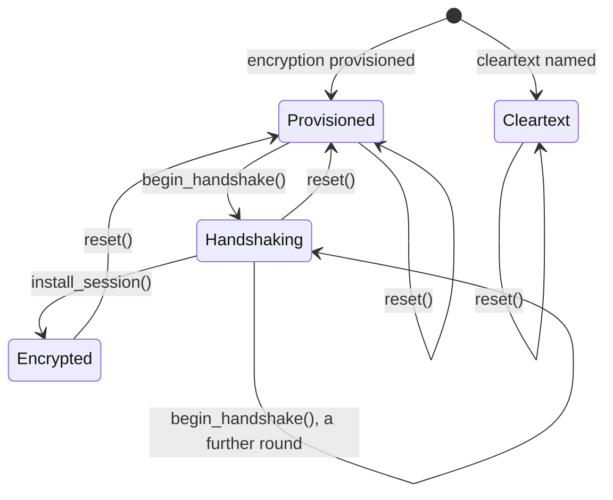
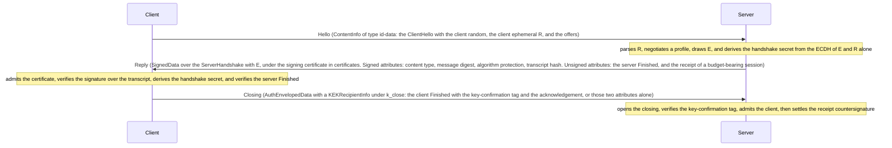
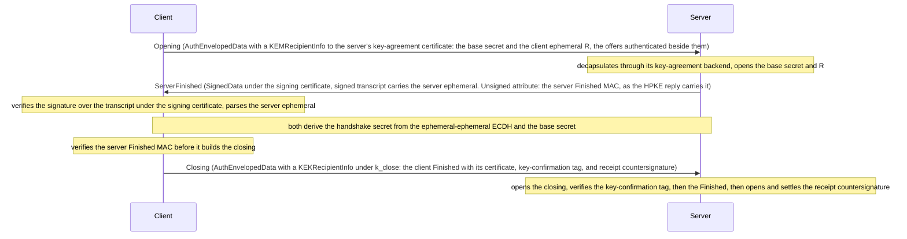
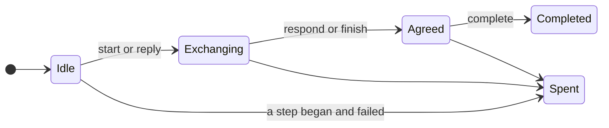
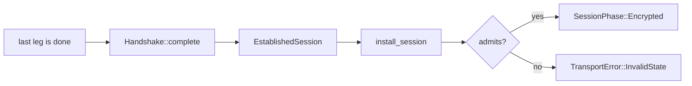
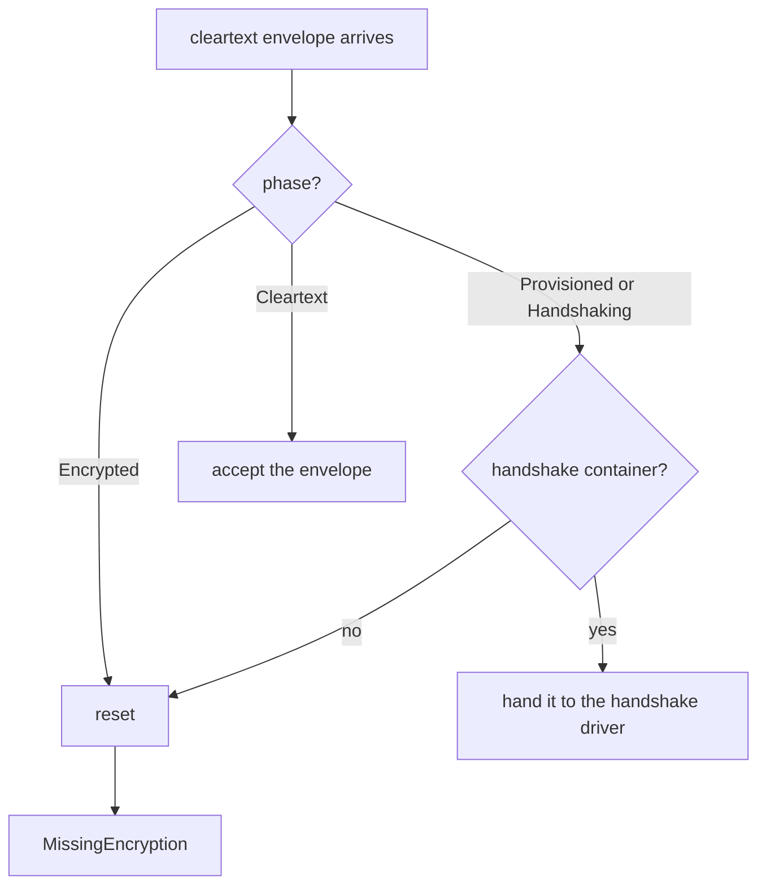

# The TightBeam Handshake

This document describes how a TightBeam session is established, which types carry that work, and which states the design refuses to represent. It covers the transport and handshake layers.

## Contents

- [Two protocols, one interface](#two-protocols-one-interface)
- [The session phase](#the-session-phase)
- [Message flow](#message-flow)
- [The orchestrator](#the-orchestrator)
- [Completion](#completion)
- [Peer authentication](#peer-authentication)
- [Key schedule](#key-schedule)
- [Transcript binding](#transcript-binding)
- [Signatures](#signatures)
- [Failure and the circuit breaker](#failure-and-the-circuit-breaker)

## Two protocols, one interface

TightBeam ships two handshake backends.

| Backend | Messages                                                                                                                                                           | The client's first message                                                                               |
| ------- | ------------------------------------------------------------------------------------------------------------------------------------------------------------------ | -------------------------------------------------------------------------------------------------------- |
| HPKE    | The TLS 1.3 shape in CMS containers: the hello as a `ContentInfo` of type `id-data`, the reply as the signer's `SignedData`, the closing as an `AuthEnvelopedData` | The hello, a `ContentInfo` of type `id-data` whose OCTET STRING is the `ClientHello`                     |
| CMS     | CMS containers, exchanged directly                                                                                                                                 | The opening, an `AuthEnvelopedData` that seals the base secret to the server's key-agreement certificate |

In both, the session keys derive from an ephemeral-ephemeral ECDH. The CMS flow adds the base secret of its opening, and the HPKE flow derives from the agreement alone. See [Key schedule](#key-schedule). Both flows send one closing, which [The closing](#the-closing) states.

Both backends meet the transport at one interface, so the driver moves a handshake message without knowing which protocol produced it. Every container is a CMS type (RFC 5652). Each travels as a `WireDer`, which keeps the decoded value together with the bytes it was encoded or received as.

```rust
pub enum HandshakeMessage {
    /// Carries the HPKE reply, or the CMS server Finished.
    SignedData(Box<WireDer<SignedData>>),
    /// Carries a CMS opening, or the closing of either flow, sealed under the
    /// closing key of the handshake secret (RFC 5083).
    AuthEnvelopedData(Box<WireDer<AuthEnvelopedData>>),
    /// Carries the HPKE hello: a `ContentInfo` of type `id-data` whose OCTET
    /// STRING is the DER of the `ClientHello`.
    Data(Box<WireDer<ContentInfo>>),
}
```

Each step accepts one container and refuses the others. A step asks for the one it expects, and any other fails the step with `HandshakeError::UnexpectedContainer`.

```rust
let hello = msg.data()?;               // refuses every other container
let opening = msg.auth_enveloped()?;   // refuses every other container
let finished = msg.signed()?;          // refuses every other container
```

On the transport, `TransportEnvelope` carries `SignedData` under context tag 3, `AuthEnvelopedData` under 7, and the `ContentInfo` of the HPKE hello under 8. Tags 2, 5, and 6 are reserved and never reused, so an archived capture never decodes a stale meaning.

Because each protocol names its own container, the driver carries no per-protocol mapping. `ClientBuilder`, the connection pool and the `client!` macro all reach the same code.

## The session phase

A transport holds one `SessionState`, which pairs the endpoint's provisioning with one `SessionPhase`. The phase is the single record of where a session sits, and once encrypted it carries everything the handshake agreed.

```rust
pub enum SessionPhase {
    Cleartext,
    Provisioned,
    Handshaking { initiated_at: MonotonicInstant },
    Encrypted(Box<EstablishedSession>),
}
```

Carrying the session inside the phase means a half-installed session cannot be represented, and leaving the phase drops every term together.

The provisioning fixes where a session starts:

- An endpoint that holds encryption material starts in `Provisioned`.
- An endpoint that named cleartext starts in `Cleartext`.
- A reset always returns the session to that start.

A further handshake round keeps the `initiated_at` of the first round, so a slow peer cannot stretch the handshake deadline by one allowance per round.



`SessionPhase::admits` holds this table. `SessionState::apply` is the one writer of the phase, and it consults the table before it writes.

A move the table does not name leaves the session where it was. `begin_handshake` and `install_session` then return `false`, so an out-of-order install fails with `TransportError::InvalidState`.

| Attempted move             | Result  | Reason                                     |
| -------------------------- | ------- | ------------------------------------------ |
| `Cleartext -> Handshaking` | Refused | A cleartext endpoint holds no key material |
| `Cleartext -> Encrypted`   | Refused | No handshake ran                           |
| `Encrypted -> Handshaking` | Refused | A live session's keys would be dropped     |
| `Encrypted -> Encrypted`   | Refused | Keys would be replaced silently            |
| `Provisioned -> Encrypted` | Refused | The handshake never started                |

## Message flow

HPKE exchanges three messages in the shape of the TLS 1.3 handshake (RFC 9846). The client learns the server from the reply, and the handshake secret derives from the two ephemerals alone, so the server's certificate key only signs.



The transcript hash covers the hello, the reply's content, and the signing certificate, which travels in `certificates` and which the reply's `sid` names, so a certificate swapped for another of the same key fails the signature (RFC 9846 § 4.5.2). An identified client's certificate travels inside its client Finished, sealed in the closing under a key of the handshake secret. See [Client identity](#client-identity).

The HPKE flow claims these properties of RFC 9846 Appendix F.1:

| Property                                                              | Claimed | Why                                                                                                                            |
| --------------------------------------------------------------------- | ------- | ------------------------------------------------------------------------------------------------------------------------------ |
| Server authentication before the client sends its identity            | Yes     | The client verifies the reply's signature over the transcript first                                                            |
| The client identity's protection against passive and active attackers | Yes     | It travels only under a key of this handshake's ephemeral agreement                                                            |
| Forward secrecy                                                       | Yes     | The secret comes from two ephemerals alone                                                                                     |
| The server identity's protection against a passive attacker           | No      | The signing certificate travels in clear in `certificates`                                                                     |
| Explicit server key confirmation                                      | Yes     | The reply carries the server Finished, and the client builds its closing only from the `ServerConfirmed` that its check yields |

CMS exchanges three messages as well, but the client leads with the opening because the base secret travels sealed to the server's key-agreement certificate. The server's signing certificate signs the server Finished, as [The CMS server's two certificates](#the-cms-servers-two-certificates) states.



The client Finished embeds the certificate and signs under its key, so the whole Finished travels sealed under a key of the handshake secret. See [Client identity](#client-identity).

Both flows send the one closing of [The closing](#the-closing), and the server reads it in one step, in this order:

1. It opens the closing under the closing key of the handshake secret it derived at the reply, as the form its content type names.
2. It compares the client ephemeral `R` with the key of the offered certificate.
3. It verifies the [key-confirmation tag](#key-confirmation).
4. It admits the client: the validity period, the validators, and then the client Finished.
5. It settles the receipt countersignature.

- The certificate checks and the proof run after the tag, so a client that derived another secret reaches no validator.
- A budget-bearing session activates only after the countersignature verifies.
- A refused settlement takes the handshake secret with it, so a replay of that message has nothing to complete with.

Both protocols negotiate the security profile through one policy, `ProfilePolicy`:

- The server chooses from its configured profiles. The list is a `SupportedProfiles`, which refuses an empty list with `NoSupportedProfiles` when it is built, so a server always has a profile to choose.
- The client admits the server's selection. It refuses a reply that selects nothing with `InvalidProfileSelection`.

## The orchestrator

One type, `Handshake<R, F, P>`, runs both roles over both protocols.

| Parameter | Values                | What it fixes                                                                                       |
| --------- | --------------------- | --------------------------------------------------------------------------------------------------- |
| `R`       | `Client`, `Server`    | The step order and every negotiation and admission decision                                         |
| `F`       | `Hpke`, `Cms`         | The messages of the protocol and the checks those messages define                                   |
| `P`       | A `HandshakeProvider` | The algorithms. The handshake reads no HPKE suite, so a provider with no HPKE suite runs both flows |

Each role runs three steps.

| Role   | Steps, in order                | Legs                                                     |
| ------ | ------------------------------ | -------------------------------------------------------- |
| Client | `start`, `respond`, `complete` | Sends the opening, reads the reply and sends the closing |
| Server | `reply`, `finish`, `complete`  | Reads the opening and sends the reply, reads the closing |

```rust
let mut client = Handshake::client(client_config);
let mut server = Handshake::server(server_config);

let opening = client.start()?;
let reply = server.reply(opening).await?;
let closing = client.respond(reply).await?;
server.finish(closing).await?;
```

The type of each configuration requires what its role cannot run without.

| Configuration           | What its type requires                                                                                                                                         |
| ----------------------- | -------------------------------------------------------------------------------------------------------------------------------------------------------------- |
| `ClientConfig<Hpke, P>` | A validator for the certificate the server names (`LearnedTrust`)                                                                                              |
| `ClientConfig<Cms, P>`  | The server's two provisioned certificates beside its trust store (`ProvisionedTrust`), and a client identity                                                   |
| `ServerConfig<F, P>`    | The flow's server identity, `F::Identity`: a `SigningIdentity` for HPKE, a `CmsIdentityPair` for CMS. A profile list that is never empty (`SupportedProfiles`) |

### Phases

Both roles run one machine, read through `HandshakePhase`.



- A step outside its phase returns `HandshakeError::InvalidState` and leaves the phase unchanged.
- A step that began and failed leaves the handshake `Spent`. Every secret the phase held drops with that step, and no later step runs.
- `Completed` and `Spent` are terminal. A client driver drops its handshake when it returns. A server transport takes its handshake out of its slot to complete it, and a spent one drops with the transport.

A phase holds the facts its steps established, so a fact exists only after its step ran.

| Phase        | Client holds                                                          | Server holds                                                              |
| ------------ | --------------------------------------------------------------------- | ------------------------------------------------------------------------- |
| `Exchanging` | The sent opening, and the secrets that await the agreement            | The negotiated terms, the handshake secret and `R`, and an issued receipt |
| `Agreed`     | The terms, the handshake secret, the receipt, and the admitted server | The terms, the handshake secret, the receipt, and the admitted client     |

## Completion

A completed handshake hands over everything it agreed in one value. Completion moves the terms out of the handshake and moves its phase to `Completed`. The terms are therefore read once, and a second completion fails with `HandshakeError::InvalidState`.

```rust
pub struct EstablishedSession {
    keys: SessionKeys,
    mux: Option<MuxSettings>,
    receipt: Option<Arc<StoredReceipt>>,
    peer: Option<Arc<Certificate>>,
    epoch: Option<EpochMaterials>,
}
```

The fields are private, so outside the crate the session answers named questions instead: `keys()`, `mux()`, `receipt()` and `peer()`.

`Handshake::complete` is the one completion of both roles, and the protocol traits delegate to it. A driver and a test therefore read the session terms the same way.

```rust
// The one completion.
let session = client.complete()?;

// Through the trait, which consumes the boxed handshake.
let session = ClientHandshakeProtocol::complete(client).await?;
```

Installing that session is one phase write. The write bounds both session ciphers by the endpoint's encrypted-envelope ceiling, so every install keeps the per-key volume inside the AES-GCM bound.

```rust
pub fn install_session(&mut self, session: EstablishedSession, encrypted_envelope: usize) -> bool {
    let bounded = session.with_envelope_ceiling(encrypted_envelope);
    self.apply(SessionEvent::Install(Box::new(bounded))).is_some()
}
```

The certificate and the receipt travel as `Arc`, so completion copies neither.



## Peer authentication

An endpoint must establish something about its peer before it dials. Any one of these does:

- A trust store.
- A server certificate.
- A requirement for a client certificate.
- A provisioned CMS server trust (`ProvisionedTrust`), which holds the store that authenticates the server.

A client identity does not count, because it proves who the client is and says nothing about the server. An endpoint that holds none of the four, and did not name cleartext, is refused before any frame is sent (CWE-295).

```rust
pub fn check_dial_permitted(&self) -> TransportResult<()> {
    if !self.is_provisioned() && !self.allow_cleartext {
        return Err(TransportError::PeerAuthenticationUnconfigured);
    }

    Ok(())
}
```

`DialableEncryption::new` runs this check, and every `SessionState` is built from a `DialableEncryption`. The builder, the connection pool, the colony dialers and the `client!` macro are therefore all covered by one check.

A frame is sent through one of two places, and each carries the decision already made:

| Writer            | What closes it                                                                                                                                                                      |
| ----------------- | ----------------------------------------------------------------------------------------------------------------------------------------------------------------------------------- |
| `apply_wire_mode` | Reads the phase. `Encrypted` sends under the session key, `Cleartext` sends in the clear, and a pending handshake fails with `EncryptorUnavailable`                                 |
| `TransportWriter` | Takes its mode from the phase at `into_split`. An encrypted half owns the send key, a cleartext half comes only from a `Cleartext` phase, and a pending handshake refuses the split |

Running without authenticating the peer stays available as a named choice.

```rust
let client = ClientBuilder::<TokioListener>::builder()
    .allow_cleartext()
    .build()
    .connect(addr)
    .await?;
```

| Configuration                          | Sends frames | Reason                                        |
| -------------------------------------- | ------------ | --------------------------------------------- |
| Trust store                            | Yes          | The peer is authenticated                     |
| Provisioned CMS server trust           | Yes          | Its store authenticates the peer              |
| Client validators                      | Yes          | A mutual-auth server authenticates its client |
| Server certificate                     | Yes          | A server presents its own identity            |
| Client identity alone                  | No           | Nothing establishes who the peer is           |
| Client identity plus `allow_cleartext` | Yes          | The risk is named                             |

### Admit a client

A server admits its client through one rule in both protocols, and `PeerAuthentication::admit` is its one home. It takes an `Offer`, which holds a certificate beside the client Finished that proves the client holds its key, or holds nothing. Both flows carry the proof the same way: the client Finished is the signer's `SignedData` over `tb/handshake/finished/client/v1`, the transcript hash, and the digest of the certificate its `sid` names, and it travels sealed in the closing with that certificate.

| Client offers                         | Anonymous server                    | Mutual server                                                                |
| ------------------------------------- | ----------------------------------- | ---------------------------------------------------------------------------- |
| Nothing                               | Admitted, no peer recorded          | Refused, `MissingClientCertificate`                                          |
| A certificate and its client Finished | Finished verified, no peer recorded | Validity period read, every validator runs, Finished verified, peer recorded |

An anonymous closing offers nothing, in either flow. A client Finished is itself the proof, so a server refuses one that names no certificate with `MissingClientCertificate`, under either policy. A CMS client always presents its identity, so it always sends a client Finished.

### Certificate use

Every certificate the handshake reads is admitted for one use and one role before its key is read. `PeerCertificate<U>` is that admission, and `PeerCertificate::parse` is its one constructor. The type that performs the use reads the key: the CMS signer a signing key, and the KEM recipient a recipient key.

| Use               | Its readers                                                                                           | `keyUsage` bit                                                           |
| ----------------- | ----------------------------------------------------------------------------------------------------- | ------------------------------------------------------------------------ |
| `Signing<P>`      | The verifier of the HPKE reply, the CMS server Finished, the client Finished, and the session receipt | `digitalSignature`                                                       |
| `KeyAgreement<K>` | The CMS client that seals the opening, and `KeyAgreementIdentity::new`                                | `RecipientKem::USAGE` of the KEM `K`, `keyAgreement` for the house DHKEM |
| `ErasedSigning`   | The trust store, and `SigningIdentity::with_provider`                                                 | `digitalSignature`                                                       |

The role is the key purpose of `extendedKeyUsage` (RFC 5280 § 4.2.1.12). `KeyPurposes` maps each role to one purpose, and `KeyPurposes::HOUSE` holds the defaults:

| Role   | Its certificates                                    | House purpose                                 | Checked by                                                                     |
| ------ | --------------------------------------------------- | --------------------------------------------- | ------------------------------------------------------------------------------ |
| Server | The server's signing and key-agreement certificates | `id-kp-serverAuth`                            | The client's `ServerTrust`, and the server's own configuration, once           |
| Client | The certificate of the client identity              | `id-kp-clientAuth`                            | The server when it opens the closing, and the client's own configuration, once |
| Signer | The certificate of a frame or colony signer         | `KEY_PURPOSE_SIGNER`, `1.3.6.1.4.1.64586.3.1` | The trust store, when it resolves the signer of a frame                        |

```asn1
id-tightbeam-kp-signer OBJECT IDENTIFIER ::= {
    iso(1) identified-organization(3) dod(6) internet(1) private(4)
    enterprise(1) 64586 keyPurposes(3) 1 }
```

Each role also admits `anyExtendedKeyUsage`, and a certificate with no `extendedKeyUsage` serves every role. Each side of a handshake carries its purposes in one place, `ClientConfig::key_purposes` and `ServerConfig::key_purposes`, and the client's `ServerTrust` admits the server under the purpose the configuration lends it. `ServerConfig::new` and `ClientConfig::new` check the endpoint's own identity for its role once, and a transport checks it once, where its provisioning is answered. An implementor sets its own purposes with `with_key_purposes` on `TransportEncryptionConfig`, `ClientBuilder`, `ConnectionPool`, and `CertificateTrustBuilder`.

The parse of each use refuses a certificate in these cases (RFC 5280 § 4.2):

- Its `keyUsage` is absent, or it lacks the bit of the use (§ 4.2.1.3).
- The bit of the use is `keyAgreement`, and its `keyUsage` also asserts `decipherOnly` (§ 4.2.1.3).
- The use reads an `id-ecPublicKey` key whose point is neither compressed nor uncompressed, so its first octet is not `0x02`, `0x03`, or `0x04` (RFC 5480 § 2.2).
- Its `extendedKeyUsage` names neither the purpose of the role nor `anyExtendedKeyUsage` (§ 4.2.1.12).
- It carries one extension twice.
- It carries a critical extension outside the set the crate processes: `basicConstraints`, `keyUsage`, `extendedKeyUsage`, and `subjectAltName`.

A certificate whose `keyUsage` carries both bits is admitted for each use. The path validation of the trust store and `DirectTrustValidator` refuse the repeated extension and the unprocessed critical extension too, so every validation path holds the same rule.

### The CMS server's two certificates

A CMS server holds two identities of one subject: a signing identity, whose key signs the server Finished and the receipt, and a key-agreement identity, whose key opens the opening. One key serves one purpose (NIST SP 800-57 Part 1 Rev. 5 § 5.2, NIST SP 800-56A Rev. 3 § 5.6.3.2), and each side holds the pair through one constructor:

| Side   | Constructor                                                   | Refuses                                                             |
| ------ | ------------------------------------------------------------- | ------------------------------------------------------------------- |
| Server | `CmsIdentityPair::new`, which `with_key_agreement` calls once | Two subjects (`SubjectMismatch`), one key in both (`KeyReuse`)      |
| Client | `ProvisionedTrust::new`, over `CmsServerCertificates`         | Two subjects, two trust anchors (`AnchorMismatch`), one key in both |

- A signing backend is a `SigningKeyProvider`, and a key-agreement backend is a `DiffieHellman<C>`. Both extend `KeyBackend`. The compiler refuses one `dyn` handle in the other's place, and `KeyReuse` refuses one key in both identities, so a backend of both serves one identity per key.
- Both constructors compare the two keys as an agreement reads them. Two elliptic-curve keys of one curve and one x-coordinate are one key, in either SEC 1 encoding and under negation. Two keys of any other kind are one key when their SubjectPublicKeyInfo is one.
- `KeyAgreementIdentity::new` admits its certificate for key agreement and refuses a backend whose public half differs from the certificate's key (`KeyMismatch`).
- `CmsServerCertificates { signing, key_agreement }` names each certificate by its field, and each is a bare certificate or a root-to-leaf `CmsServerChain`. `CmsServerChain::new` refuses an empty chain and holds the leaf apart, so each admission lends the leaf without a copy.
- A bare certificate names its trust anchor by its issuer and its `authorityKeyIdentifier`, or by itself when it is self-issued. A chain names its first certificate.
- `ProvisionedTrust::new` admits each certificate against the store once, where the client is configured: `ClientBuilder::with_cms_server` and `ConnectionPool`'s take the built trust. The client admits both again before each opening, against the store, within the validity period, and for its use, because the verdict and the period change after construction.
- An HPKE server holds its one signing identity, and its secret derives from the two ephemerals alone.
- A transport server of the CMS flow that holds a signing identity alone refuses the handshake with `MissingKeyAgreementIdentity` before it reads the opening.

## Key schedule

Both backends and both roles derive every traffic key from one `HandshakeSecret`. It has two constructors, each reached through its own `Agreement` constructor:

| Flow | Constructor                                                  | Input                                           |
| ---- | ------------------------------------------------------------ | ----------------------------------------------- |
| CMS  | `HandshakeSecret::hybrid`, through `Agreement::hybrid`       | `Z′ = ee \|\| base`, NIST SP 800-56C Rev. 2 § 2 |
| HPKE | `HandshakeSecret::ephemeral`, through `Agreement::ephemeral` | `Z = ee`                                        |

```text
hs      = HKDF(ee || base, salt = S, info = "tb/session/kdf/v1")    CMS
hs      = HKDF(ee, salt = S, info = "tb/session/kdf/v1")            HPKE
k_c2s   = HKDF(hs, S, "tb/session/kdf/c2s/v1")
k_s2c   = HKDF(hs, S, "tb/session/kdf/s2c/v1")
epoch_0 = HKDF(hs, S, "tb/session/kdf/epoch/v1")
k_ack   = HKDF(hs, S, "tb/session/kdf/ack/v1")
k_close = HKDF(hs, S, "tb/session/kdf/closing/v1")
mac_c   = HKDF-Expand-H(HKDF-Extract-H(S, hs), "tb/handshake/finished/client/mac/v1", Hash.length)
mac_s   = HKDF-Expand-H(HKDF-Extract-H(S, hs), "tb/handshake/finished/server/mac/v1", Hash.length)
confirm = HMAC-H(mac_c, transcript_hash)
server  = HMAC-H(mac_s, transcript_hash || SignerInfo.signature)
```

| Input  | What it is                                                                                                     |
| ------ | -------------------------------------------------------------------------------------------------------------- |
| `ee`   | The ECDH output of the client's ephemeral and the server's ephemeral                                           |
| `base` | The 32-byte base secret the CMS client seals to the server's key-agreement certificate. The HPKE flow has none |
| `S`    | The salt: `client_random \|\| server_random` for HPKE, the transcript hash for CMS                             |
| `HKDF` | The KDF of the profile, extract then expand under its own hash: HKDF-SHA3-256 in the default profile           |
| `H`    | The negotiated digest, SHA3-256 in the default profile. `Hash.length` is its output length                     |

`ee || base` is the hybrid shared secret `Z′ = Z || T` of NIST SP 800-56C Rev. 2 § 2: the shared secret `Z` of the key-establishment scheme, followed by an auxiliary secret `T` whose content, format, and length both endpoints fix in advance. Each part is 32 bytes wide, so the plain concatenation is unambiguous. The HPKE secret takes `ee` alone, as the ECDHE secret of TLS 1.3 does (RFC 9846 § 7.1).

### Ephemeral keys

The server draws a fresh ephemeral, `E`, for each handshake and carries it inside the transcript it signs. A client draws `R` for this agreement alone. The CMS opening's KEM draws an ephemeral of its own for its seal, whose shared secret derives the key-encryption key alone (RFC 9629 § 7).

| Step                          | HPKE                                                               | CMS                                        |
| ----------------------------- | ------------------------------------------------------------------ | ------------------------------------------ |
| Client ephemeral              | `R`, a field of the hello in clear, as TLS 1.3 sends its key share | `R`, a field of the sealed opening content |
| Client draws its private half | In `start`, with the hello                                         | In `start`, with the opening               |
| Client drops its private half | In `respond`, at the agreement                                     | In `respond`, at the agreement             |
| Server drops its private half | In `reply`, at the agreement, before it encodes the reply          | In `reply`, at the agreement               |

Every received ephemeral is parsed before any scalar multiplication runs on it. `PeerPoint::parse` is the one parse of an ephemeral that the handshake secret agrees with, and `PeerEphemeral` runs it before its comparison. It refuses a malformed, off-curve, or identity point, and the agreement of the handshake secret takes no other point type.

An ephemeral with the x-coordinate of its sender's static key would collapse the agreement into the static one, so each side refuses it. The two sides learn that static key at different times, so the comparison has two homes:

| Comparison                                                                                                                                | Home            | When                                                    |
| ----------------------------------------------------------------------------------------------------------------------------------------- | --------------- | ------------------------------------------------------- |
| A client compares `E` with the key of each server certificate: the signing certificate, and the key-agreement certificate of a CMS server | `PeerEphemeral` | At the reply, before the agreement                      |
| A server compares `R` with the key of the offered certificate                                                                             | `Offer::new`    | At the closing, once the identity opens, before the tag |
| A rekey server compares `Ce` with the client's static key                                                                                 | `PeerEphemeral` | At the request, where the client's key is already known |
| A rekey client compares `Se` with the server's static key                                                                                 | `PeerEphemeral` | At the response                                         |

Three facts fix what a server compares:

- The comparison is on the x-coordinate. ECDH keeps that coordinate alone, so a key and its negation agree to one secret.
- The client's static key is the key of the certificate it offers, which a server reads only once the identity opens. An anonymous client holds none.
- A CMS opening carries the KEM's ephemeral as `kemct`. Its shared secret derives the key-encryption key alone and never feeds the handshake secret, so the server compares `R` alone.
- A key-agreement certificate whose SPKI names no point of the handshake curve collapses no agreement on that curve, so the client compares `E` with its key only as a point of that curve.

### Forward secrecy

An observer who records a session and later obtains the server's static keys recovers nothing below `hs`. The HPKE server's one key only signs, so it opens no part of the session. The CMS server's signing key opens nothing, and its key-agreement key opens the opening, and so the base secret alone.

| Value                       | HPKE observer with the static keys | CMS observer with the static keys | Reason                                          |
| --------------------------- | ---------------------------------- | --------------------------------- | ----------------------------------------------- |
| `base`                      | No such value                      | Recovers                          | The key-agreement key opens the CMS opening     |
| `S`                         | Recovers                           | Recovers                          | Public in the handshake messages                |
| `ee`                        | Does not recover                   | Does not recover                  | Needs `r` or `e`, and neither side kept its own |
| `hs` and every key below it | Does not recover                   | Does not recover                  | An input unknown                                |
| Client identity             | Does not recover                   | Does not recover                  | Sealed under `k_close`, below `hs`              |

The traffic keys, the sealed receipt acknowledgement, the closing, and every rekey epoch sit below `hs`, so the rekey chain inherits the property.

### Rekey

Each renewal runs a fresh agreement. The client sends an ephemeral `Ce` on the request, and the server an ephemeral `Se` on the response.

```text
epoch_next = HKDF(u32be(32) || epoch || u32be(32) || ee, salt = client_random || server_random, info = "tb/session/kdf/epoch/v1")
```

`ee` is the ECDH output of the two rekey ephemerals, and `u32be(n)` is the 4-byte big-endian length of the input that follows it. A holder of one epoch secret who records the renewal lacks `ee`, so the holder derives nothing of the next epoch.

| Rule                                                                      | Where it is enforced                                                                                                                                  |
| ------------------------------------------------------------------------- | ----------------------------------------------------------------------------------------------------------------------------------------------------- |
| The next epoch needs a rekey scalar                                       | `EpochSecret::next` runs the agreement itself                                                                                                         |
| Both ephemerals are authenticated                                         | The server signs a receipt over `H(hash \|\| request \|\| server_random \|\| Se)`, the request carries `Ce`, and the client countersigns that receipt |
| A peer ephemeral is a point on the curve, and never the peer's static key | `PeerEphemeral` yields a `PeerPoint`, the one point type `EpochSecret::next` takes                                                                    |
| The server holds no rekey scalar across an await or between legs          | It agrees and drops its scalar before it awaits its authorizer, and it holds the derived secret until the acknowledgement                             |
| The client holds its rekey scalar across no await of a step               | The scalar waits boxed between the request and the response. `EpochSecret::next` takes it by value before the client awaits its approver              |

### Traffic secrets

The directional derivation accepts only a `TrafficSecret`, a sealed trait with two implementors. Every traffic key therefore traces back to a handshake secret.

| Secret            | Constructors                                                                                                      |
| ----------------- | ----------------------------------------------------------------------------------------------------------------- |
| `HandshakeSecret` | `HandshakeSecret::hybrid` for the CMS flow, `HandshakeSecret::ephemeral` for the HPKE flow                        |
| `EpochSecret`     | `EpochMaterials::derive`, from a handshake secret. `EpochSecret::next`, from the last epoch and a fresh agreement |

### Seals

Every seal of the handshake is an `AuthEnvelopedData` (RFC 5083) under the provider's AEAD, AES-256-GCM for the house provider. Each envelope holds to these rules:

- Each seal draws a random content key of the key size of the provider's AEAD, 32 octets for the house provider, and a random 12-octet nonce.
- `GCMParameters` (RFC 5084 § 3.2) names the nonce and a 16-octet tag, and the tag travels in `mac`.
- `AuthEnvelopedData::seal` takes the content by value and encrypts it in place, so a content buffer that moves in becomes the `encryptedContent`.
- `AuthEnvelopedData::open` takes the envelope by value and decrypts the ciphertext in the buffer it arrived in, so the content is never copied.
- The authenticated attributes carry the content type. Their DER under the universal `SET OF` tag is the associated data (RFC 5083 § 2.2), so an opener refuses authenticated attributes that did not arrive in DER.
- One `RecipientInfo` wraps the content key with the provider's key wrap: AES-256 key wrap, `id-aes256-wrap` (RFC 3565, RFC 3394), for the house provider. The cipher, the KDF, the wrap, and the KEM are each the provider's, and an opener refuses an envelope that names another.

| Seal                        | Recipient                                                               | Key-encryption key                                                                                                                                                                             |
| --------------------------- | ----------------------------------------------------------------------- | ---------------------------------------------------------------------------------------------------------------------------------------------------------------------------------------------- |
| The CMS opening             | `KEMRecipientInfo` (RFC 9629) to the server's key-agreement certificate | The provider's KDF of the DHKEM shared secret, empty salt, `DER(CMSORIforKEMOtherInfo)` as `info`, for the key size of the provider's wrap: HKDF-SHA3-256 and 32 octets for the house provider |
| The receipt acknowledgement | `KEKRecipientInfo` (RFC 5652 § 6.2.3)                                   | `k_ack`                                                                                                                                                                                        |
| The closing of either flow  | `KEKRecipientInfo`                                                      | `k_close`                                                                                                                                                                                      |

`Opener::unwrap` is the one decision on the kind of a `RecipientInfo`. Before any key runs, it refuses another recipient kind, a `ukm` of another purpose, a `kekid` of another key, an algorithm outside the profile, and a `kekLength` other than the key size of the provider's wrap, 32 for the house provider. `AuthEnvelopedData::open` refuses authenticated attributes that did not arrive in DER, a version other than 0, a cipher other than the provider's AEAD with `GCMParameters`, AES-256-GCM for the house provider, a tag length other than 16, a missing content-type attribute, and another content type.

#### The opening

The opening's `KEMRecipientInfo` holds these fields.

| Field       | Value                                                                                                                                                  |
| ----------- | ------------------------------------------------------------------------------------------------------------------------------------------------------ |
| `version`   | 0                                                                                                                                                      |
| `rid`       | The key-agreement certificate's `subjectKeyIdentifier`, else its issuer and serial number                                                              |
| `kem`       | `1.3.6.1.4.1.64586.2.3`, parameters absent: DHKEM(secp256k1, HKDF-SHA256), HPKE KEM `0x0016`, which [dhkem-secp256k1.md](dhkem-secp256k1.md) specifies |
| `kemct`     | DHKEM's `enc`, the 65-octet uncompressed point of an ephemeral drawn for this seal                                                                     |
| `kdf`       | `id-alg-hkdf-with-sha3-256` (RFC 9688 § 5.1), parameters absent, so the salt is empty                                                                  |
| `kekLength` | 32                                                                                                                                                     |
| `ukm`       | `tb/handshake/opening/ukm/v1` followed by 32 random octets that the seal draws for itself                                                              |
| `wrap`      | `id-aes256-wrap`                                                                                                                                       |

- The content, of type `1.3.6.1.4.1.64586.1.25`, is `SEQUENCE { baseSecret OCTET STRING, agreementKey OriginatorPublicKey }`: the base secret and `R`.
- The authenticated attributes carry the security and transport offers beside the content type. The unauthenticated attributes carry the abort alert alone.
- The server opens the opening, and so checks its tag, before it chooses a profile or asks its transport authorizer, so neither reads an offer the tag has not covered.
- The server's key-agreement backend, a `DiffieHellman<C>`, runs `DH(skS, enc)`, so the static key can stay behind an external boundary. The DHKEM shared secret derives the key-encryption key alone (RFC 9629 § 7).
- The key-agreement certificate receives the opening, and the signing certificate signs the Finished, as [The CMS server's two certificates](#the-cms-servers-two-certificates) states. The client seals only to a certificate admitted for key agreement, and the server opens only under one, so a certificate whose `keyUsage` lacks `keyAgreement` receives no opening (RFC 5480 § 3).

#### Seals under the handshake secret

The acknowledgement and the closing each seal under a key of the handshake secret, through a `KEKRecipientInfo` of version 4:

- The key-encryption key is `k_ack` or `k_close`, of the key size of the provider's wrap, 32 octets for the house provider.
- `kekid.keyIdentifier` is the purpose's label followed by the transcript hash: `tb/handshake/ack/kekid/v1` for the acknowledgement, `tb/handshake/closing/kekid/v1` for the closing.
- The transcript hash is also an authenticated attribute (`1.3.6.1.4.1.64586.1.8`), which the opener checks before the content decrypts, so a seal moved to another session fails to open, even under the right key.
- The acknowledgement's content type is `id-data`. The closing's content type names its form, `id-signedData` or `id-data`, as [The closing](#the-closing) states. The closing's plaintext is padded inside the frame that [Client identity](#client-identity) states.

### Receipt acknowledgement

The acknowledgement is the client's receipt `SignerInfo`, sealed under `k_ack` as [Seals](#seals) states. The DER of its envelope travels in the `RECEIPT_ACK` attribute of the closing, inside the closing's seal: an unsigned attribute of the client Finished, or a member of the attribute set of an anonymous closing.

- A sealed answer moved to another session fails to open, even under the right key.
- The label names the acknowledgement's key in the `kekid`, so an opener of another purpose refuses the seal by its key identifier.

### The closing

Both flows derive the handshake secret at the reply, and both close with one `AuthEnvelopedData` that holds one `KEKRecipientInfo` under `k_close`. The client builds it only from the `ServerConfirmed` that `ServerConfirmed::confirm` yields, and `confirm` takes the `ReplyVerified` that only `ClientLegs::verify_reply` yields, so no closing exists before the client verified the reply's signature and confirmed the server. The closing has two forms, and the content type that the closing's `authAttrs` authenticate names the form:

| Form            | Content type    | Content                                                                                                                                                                                                                                                       |
| --------------- | --------------- | ------------------------------------------------------------------------------------------------------------------------------------------------------------------------------------------------------------------------------------------------------------- |
| Client Finished | `id-signedData` | The signer's `SignedData` over `tb/handshake/finished/client/v1`, the transcript hash, and the digest of the client certificate, with the client certificate in `certificates` and the tag and the acknowledgement as unsigned attributes of its `SignerInfo` |
| Anonymous       | `id-data`       | The DER `SET OF Attribute` that holds the tag and the acknowledgement alone                                                                                                                                                                                   |

`ClosingContent` is the one reader of both forms:

- Its constructor is the one branch on the content type. `id-signedData` reads as the client Finished, `id-data` as the attribute set, and any other type is refused with `UnexpectedContainer` before the closing key runs.
- Its one read returns the key-confirmation tag and the acknowledgement from the attribute set of either form. A form that carries either attribute twice is refused with `DuplicateAttribute`, and one that carries no tag with `MissingAttribute`.
- The certificate of a client Finished is the one its `sid` names. It moves out of the Finished into the offered identity, and a Finished that names no certificate is refused with `MissingClientCertificate`.

The closing draft holds the client Finished beside the identity that signs it, and its one seal signs that Finished and seals the closing, so no closing carries a Finished without its signature. A server refuses a closing whose unauthenticated attributes carry an abort alert before any key runs.

### Client identity

An identified client seals its certificate inside its client Finished, under `k_close`, as [The closing](#the-closing) states.

- The server verifies the certificate of `certificates` that the Finished's one `sid` names (RFC 5652 § 5.3), so the set may also carry the chain of that certificate in any order.
- The sealed plaintext is a big-endian `u16` length, the content DER, and zero bytes up to the next multiple of 512 bytes, at least 1024. Certificates whose lengths differ within one block give closings of one length. A client Finished adds about 440 bytes to its certificate, and about 1060 when it carries a receipt countersignature. A fleet therefore reaches the first block boundary at certificates of about 580 bytes, and every budget-bearing identified closing pads to 1536 bytes or more.
- Two signals remain by decision. A fleet whose identities straddle a block boundary splits into two lengths. The content type of the closing travels in clear, so a closing that offers an identity shows its presence, as a TLS 1.3 client certificate shows its presence by its length.
- A passive observer reads no byte of the certificate, its key identifier, its issuer and serial number, its key, or the signature.
- An observer that later obtains the server's static keys lacks `ee` and therefore `k_close`. The CMS server's key-agreement key opens the opening alone, and every other server key opens nothing.
- `k_ack` and `k_close` derive under two labels from one `hs`, and each wraps the random content key of one seal.

### Key confirmation

The client proves on the closing that it derived `hs`, and the server of either flow proves it on the reply. Each tag follows the Finished construction of TLS 1.3 (RFC 9846 § 4.5.3) under the negotiated digest `H`, with one `MacKey` per role, as that section keys each Finished from its own secret. The crate's label is the HKDF-Expand info in place of `HkdfLabel`:

1. `hs` is the 32-byte output of the profile's KDF. RFC 5869 § 2.3 asks for a PRK of at least `Hash.length` octets, so `hs` is too short a PRK for a 64-byte digest. `HKDF-Extract-H(S, hs)` therefore makes a PRK first, under every digest.
2. Each role expands its own `MacKey` from that PRK to `Hash.length` bytes: `mac_c` under `tb/handshake/finished/client/mac/v1`, and `mac_s` under `tb/handshake/finished/server/mac/v1`. `FinishedRole` names both labels beside its signature domains, and no label serves another purpose.
3. `confirm = HMAC-H(mac_c, transcript_hash)`, the client's tag.
4. `server = HMAC-H(mac_s, transcript_hash || SignerInfo.signature)`, the server Finished MAC of both flows. The second input is the octets of the reply's one signature, which bind everything that signature binds.

Each tag is as wide as the output of `H`: 32 bytes under SHA3-256, 64 under SHA3-512. NIST SP 800-56A Rev. 3 § 5.9 is not claimed. Its confirming party owns a static key-establishment key, and the client owns none.

| Tag       | Sender                    | Where it travels, under OID `1.3.6.1.4.1.64586.1.24`                                                         | A message with no tag fails with                |
| --------- | ------------------------- | ------------------------------------------------------------------------------------------------------------ | ----------------------------------------------- |
| `confirm` | The client of either flow | Inside the closing: an unsigned attribute of the client Finished, or a member of the anonymous attribute set | `MissingAttribute`, where the closing opens     |
| `server`  | The server of either flow | An unsigned attribute of the reply's `SignerInfo`                                                            | `MissingAttribute`, before the closing is built |

- A client tag that differs is refused with `KeyConfirmationFailed`. The refusal runs ahead of settlement, so the authorizer's settlement and the session observer hear nothing of a client that holds another secret.
- A server Finished that differs is refused with `KeyConfirmationFailed`. `ServerConfirmed::confirm` yields the `ServerConfirmed` that the closing takes only when the server Finished verifies, so the client sends no closing to a server that holds another secret.
- A tag that repeats is refused with `DuplicateAttribute`. A tag of another digest's width differs, so it is refused as a tag that differs. A tag narrower than 32 bytes or wider than 64 fails to decode.
- Each tag derives from `hs` and the transcript hash, so it reveals neither and confirms no other handshake. Neither attribute therefore needs a signature over it.
- The CMS server Finished signs the transcript, and its reply carries the same MAC as the HPKE reply, so the client of either flow learns at the reply that the secrets match.

## Transcript binding

The transcript hash is the whole output of the negotiated digest: 32 bytes under SHA3-256, 64 under SHA3-512. A digest whose output is narrower than 32 bytes or wider than 64 fails the seal with `TranscriptDigestLength`. Every value that carries the hash takes that width:

- the CMS salt and the content each Finished signs,
- the transcript-hash attribute the HPKE reply signs, and the input of the server Finished MAC,
- the `kekid` and the authenticated attributes of each seal under the handshake secret,
- the `DigestInfo` of the session receipt, and
- the root of the rekey chain, and each link after it.

`Transcript` is the one construction of both transcripts. Each flow binds its legs in one order, which both of its roles run:

| Flow | Legs, in order                                                                                                      |
| ---- | ------------------------------------------------------------------------------------------------------------------- |
| HPKE | The hello `ContentInfo` DER, the `ServerHandshake` DER the reply signs, and the DER of the signing certificate      |
| CMS  | The opening DER, then the server Finished legs: the security accept, the transport accept, and the server ephemeral |

The sender hashes the bytes it encoded, and the receiver hashes the bytes it received, so the binding is byte-level. The receiver hashes the bytes that arrived, and not a re-encoding of what it decoded. The pinned `der` decoder is the reason:

1. The decoder sorts a `SET OF` before it validates it, so a mis-ordered set decodes to the same value as the well-ordered one.
2. A re-encoding of that value is the well-ordered bytes, whatever arrived.
3. Hashing the bytes that arrived makes a reordered set diverge the two transcript hashes, and signature verification fails (CWE-345).

| What the transcript binds           | Read through                                                                                               |
| ----------------------------------- | ---------------------------------------------------------------------------------------------------------- |
| A container                         | `WireDer::der`                                                                                             |
| A CMS accept or ephemeral attribute | `HandshakeAttribute::received_bytes`                                                                       |
| The HPKE reply content              | The `eContent` octets of the reply, as they arrived                                                        |
| The HPKE signing certificate        | `CmsSigner::signer_certificate_der`, the bytes of the certificate the reply's `sid` names, as they arrived |

The HPKE reply's content carries the security accept, the certificate demand, the transport accept, and the server ephemeral, so the transcript binds each of them as the server signed it. The certificate binding follows RFC 9846 § 4.5.2, which signs over the Certificate: a reply whose certificate was swapped for another of the same key gives the client another transcript, and the signature fails.

The HPKE reply signs under a content type of its own, and each Finished signs a label of its own ahead of the transcript hash. Neither Finished label is a prefix of the other, which a compile-time assertion holds, so a signature made for one purpose verifies as no other.

| Signature           | What it signs                                                                                                                                                                          |
| ------------------- | -------------------------------------------------------------------------------------------------------------------------------------------------------------------------------------- |
| HPKE reply          | Its signed attributes: content type `1.3.6.1.4.1.64586.1.26`, the message digest of the `ServerHandshake` DER, algorithm protection, and the transcript hash (`1.3.6.1.4.1.64586.1.8`) |
| CMS server Finished | Its signed attributes, whose message digest covers its content: `tb/handshake/finished/server/v1` and the transcript hash                                                              |
| Client Finished     | Its signed attributes, whose message digest covers its content: `tb/handshake/finished/client/v1`, the transcript hash, and the digest of the client certificate (RFC 9846 § 4.5.2)    |

Both transcripts bind both ephemerals.

| Ephemeral        | Bound by                                                                                       | Tampering fails at                                                                                                                                                                      |
| ---------------- | ---------------------------------------------------------------------------------------------- | --------------------------------------------------------------------------------------------------------------------------------------------------------------------------------------- |
| Server `E`, HPKE | A field of the `ServerHandshake`, which the reply signs and the transcript binds               | The reply signature. A point off the curve fails `InvalidPublicKey` at the parse that follows it                                                                                        |
| Server `E`, CMS  | The last `ServerFinishedLegs` entry before the transcript seals                                | The server signature. A removed one fails `MissingAttribute` before the seal                                                                                                            |
| Client `R`, HPKE | A field of the `ClientHello`, whose `ContentInfo` DER is the first transcript leg              | The client's check of the reply signature, whose transcript hash the server took over the hello it received. A point off the curve fails `InvalidPublicKey` at the server's hello parse |
| Client `R`, CMS  | The opening content carries `R` under the tag, and the opening DER is the first transcript leg | The opening's tag (`HandshakeError::Envelope`). A point off the curve fails `InvalidPublicKey` at the content parse                                                                     |

A swapped server ephemeral fails the server signature before any key agreement runs.

## Signatures

Every handshake signature is made under a `SigningIdentity`: a certificate and the `SigningKeyProvider` that holds its private key. Its constructor refuses a certificate that is not admitted for signing ([Certificate use](#certificate-use)), and a key whose public half differs from the certificate's SubjectPublicKeyInfo, so a signature verifies under the certificate it names.

| Endpoint        | Where the identity is held                                                                                                                             |
| --------------- | ------------------------------------------------------------------------------------------------------------------------------------------------------ |
| Server          | `ServerConfig.identity`, which `TransportEncryptionConfig::new` fills. A CMS server holds it in the `CmsIdentityPair` that `with_key_agreement` builds |
| CMS client      | `CmsClientSettings.identity`                                                                                                                           |
| HPKE client     | `HpkeClientSettings.identity`, absent for an anonymous client                                                                                          |
| Transport build | `with_client_identity` on `ClientBuilder` and `ConnectionPool`, and the `client!` macro                                                                |

Each signature value is the DER `ECDSA-Sig-Value` (RFC 3279 § 2.2.3), and every handshake signature carries it in a `SignerInfo`: the HPKE reply, the CMS server Finished, the client Finished of both flows, and the session receipt.

- A signer emits `s` in the low half of the curve order. The identity brings every value its provider returns to that form, and refuses a value that is not DER.
- A verifier parses DER alone, so a raw `r‖s` signature fails. It normalizes `s` to the low half and then verifies, because ECDSA verifies both values (SEC 1 v2.0 § 4.1.4).
- The verified signature in that low-`s` form is the replay key, so a capture with `s` flipped finds the slot its original spent.

One signer of `crypto::sign`, `CmsSigner`, builds every `SignerInfo` the handshake emits, and every `SignedData` that carries one, and verifies every one it reads (RFC 5652 § 5.4).

| Field                         | Rule                                                                                                                        |
| ----------------------------- | --------------------------------------------------------------------------------------------------------------------------- |
| `SignerInfo.sid`              | The subjectKeyIdentifier extension of the certificate, or its issuer and serial number when it carries none                 |
| `SignerInfo.version`          | 3 under a subjectKeyIdentifier, 1 under an issuer and serial number (RFC 5652 § 5.3)                                        |
| `SignerInfo.digestAlgorithm`  | The digest the signature algorithm names (RFC 5753 § 2.1.1), fixed by the signature type                                    |
| `SignerInfo.signedAttrs`      | Content type, message digest, and `CMSAlgorithmProtection` (RFC 6211), beside the attributes of the profile. Always present |
| `SignedData.version`          | The rule of RFC 5652 § 5.1, which a reader checks before it reads the content                                               |
| `SignedData.digestAlgorithms` | Every digest algorithm a signer names                                                                                       |

- A reader refuses a digest the signature algorithm does not name, a missing or extra signed attribute, an algorithm protection that names other algorithms, and a version that breaks its rule.
- The signer returns a `SignedData` as `Signed<SignedData>`, the form a session receipt keeps, and a `SignerInfo` as `Signed<SignerInfo>`, the form a frame keeps. The signer builds each value the crate emits, and the DER decoder yields each one it reads.
- The HPKE hello travels as a `ContentInfo` of type `id-data` and carries no signature. The reply's transcript hash covers it.

## Failure and the circuit breaker

`SessionState::reset` returns a session to its start. Because the phase carries the session, the reset drops the keys, the receipt, the peer certificate, the mux terms and the epoch materials together.



The colony gates and the cluster export rules authorize a request by the peer certificate, so a session that was torn down must not leave the previous peer's identity readable.

An end of stream is named by the phase it interrupted.

| The peer disconnects while | Error                                                                |
| -------------------------- | -------------------------------------------------------------------- |
| A handshake is pending     | `PeerClosedBeforeHandshake`                                          |
| A session is agreed        | `ConnectionClosed`, which a pool acts on when it evicts a connection |

## Sources

- RFC 5652, Cryptographic Message Syntax: <https://datatracker.ietf.org/doc/html/rfc5652>
- RFC 5083, CMS Authenticated-Enveloped-Data Content Type: <https://datatracker.ietf.org/doc/html/rfc5083>
- RFC 5084, AES-CCM and AES-GCM in CMS, § 3.2 on `GCMParameters`: <https://datatracker.ietf.org/doc/html/rfc5084#section-3.2>
- RFC 9629, Using Key Encapsulation Mechanism (KEM) Algorithms in CMS: <https://datatracker.ietf.org/doc/html/rfc9629>
- RFC 9688, Use of the SHA3 One-Way Hash Functions in CMS, § 5.1 on HKDF with SHA3-256: <https://datatracker.ietf.org/doc/html/rfc9688#section-5.1>
- RFC 3394, AES Key Wrap Algorithm, and RFC 3565, AES in CMS: <https://datatracker.ietf.org/doc/html/rfc3394>, <https://datatracker.ietf.org/doc/html/rfc3565>
- RFC 5280, Internet X.509 Public Key Infrastructure Certificate and CRL Profile: <https://datatracker.ietf.org/doc/html/rfc5280>
- RFC 5480, Elliptic Curve Cryptography Subject Public Key Information, § 3 on `keyUsage`: <https://datatracker.ietf.org/doc/html/rfc5480#section-3>
- RFC 5869, HMAC-based Extract-and-Expand Key Derivation Function (HKDF): <https://datatracker.ietf.org/doc/html/rfc5869>
- RFC 5116, An Interface and Algorithms for Authenticated Encryption, § 3.1 on nonce generation: <https://datatracker.ietf.org/doc/html/rfc5116#section-3.1>
- RFC 9846, The Transport Layer Security (TLS) Protocol Version 1.3, § 4.5.2 on the signature over the Certificate: <https://datatracker.ietf.org/doc/html/rfc9846#section-4.5.2>
- RFC 9846, § 4.5.3 on the Finished construction and a Finished key per role: <https://datatracker.ietf.org/doc/html/rfc9846#section-4.5.3>
- RFC 9846, § 7.1 on the ECDHE shared secret, and Appendix F.1 on the handshake's security properties: <https://datatracker.ietf.org/doc/html/rfc9846#appendix-F.1>
- NIST SP 800-56C Rev. 2, Recommendation for Key-Derivation Methods in Key-Establishment Schemes, § 2 on the hybrid shared secret: <https://doi.org/10.6028/NIST.SP.800-56Cr2>
- NIST SP 800-56A Rev. 3, Pair-Wise Key-Establishment Schemes Using Discrete Logarithm Cryptography, § 5.9 on key confirmation, which the tag does not claim: <https://doi.org/10.6028/NIST.SP.800-56Ar3>
- CWE-295, Improper Certificate Validation: <https://cwe.mitre.org/data/definitions/295.html>
- CWE-311, Missing Encryption of Sensitive Data: <https://cwe.mitre.org/data/definitions/311.html>
- CWE-345, Insufficient Verification of Data Authenticity: <https://cwe.mitre.org/data/definitions/345.html>
